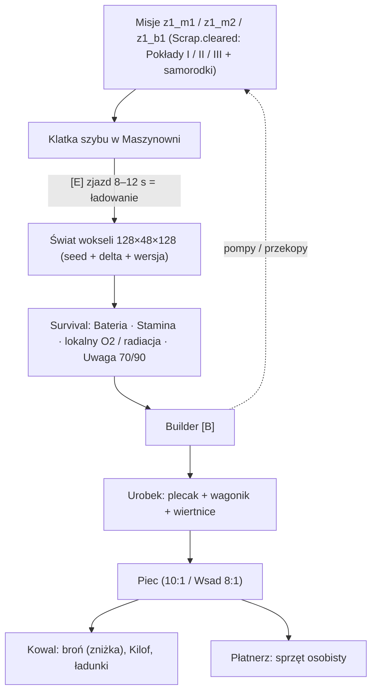

# Plan: Podgra First-Person 3D Voxel Mining — Survival, Builder, Plecak i Rzemiosło

Status: **zatwierdzony do realizacji — v6 po drugiej analizie zgodności z kodem** (2026-10-18).
Prototyp interaktywny 3D: artefakt claude.ai `mine_fp3d_voxel.html` (brak kopii lokalnej; do przeniesienia do `gameon/concepts/mine_voxel/index.html` w Etapie 0).
Podstawa kodu: stan `origin/main` **1.7.284** (35f905d) — `prototype/scripts/maps/z1_hub.gd`, `level.gd`, `lobby.gd`, `main.gd`, `scrap.gd`, `upgrades.gd`, `player.gd`, `profile.gd`, `pickup.gd`, `perks.gd`, `workshop.gd`, `workshop_ui.gd`, `mission.gd`, `actions.gd`, `audio_manifest.gd`, `view3d.gd`.

**Historia zmian:**
- **v3:**
  - ekonomia sztabkowa i cel czasu 1:1,
  - pancerz `+1` na strefę, maks. 1 pkt na trafienie,
  - Pokład III po B1,
  - świat `128×48×128` zapisywany jako `seed + delta`,
  - Poziom Uwagi zamiast sejsmiki,
  - reguły co-op, bramka MVP.
- **v4:**
  - kopalnia **opcjonalna** (przyspiesza, nie blokuje broni I–II),
  - sprzęt osobisty **na gracza**,
  - trwały zapis ukończonych map (`Scrap.cleared`) + migracja starych zapisów,
  - reguły trybów Nocny Dyżur / Kryjówka,
  - wersjonowanie i determinizm generatora,
  - strategia wydajności i ładowania,
  - wydatki T3 po B1,
  - doprecyzowane mechaniki: zawały, metan, Pasożyty, ekwipunek, rozłączenia, rozkład rud, samorodki, wsad, limity farmienia, samouczek,
  - mierzalna bramka MVP, dźwięk, dostępność, perki górnicze.
- **v5** (zgodność z kodem 1.7.284):
  - **jawny wyjątek od zasady „symulacja zostaje 2D”** — kopalnia to osobna symulacja 3D (§2A0, wpis do `CLAUDE.md`; od v6 w Etapie 0),
  - **architektura hub + kopalnia jednocześnie** w co-op: gracz „w szybie” zostaje zaparkowany w hubie, host trzyma dane wokseli bez meshowania (§2A0, §7),
  - **identyfikator profilu** `Profile.uid` (dziś `profile.gd` go nie ma) jako klucz sprzętu osobistego (§6),
  - rozdzielenie `Scrap.cleared` (stan kampanii u hosta) od `Profile.completed` (bonus XP gracza); migracja korzysta z obu (§6),
  - **ścieżka bez kopalni bez zmian** względem obecnej gry: wszystkie poziomy I–III za sam złom `×1,0`; kopalnia daje zniżkę, a nie odblokowanie (§0, §5D),
  - pancerz pochłania tylko w `apply_hit()` — `apply_chip()` i tak kończy się `apply_hit(1)` (§5E),
  - nowe nazwy Pasożytów — „Pijawka” to boss B1 (`leech.gd`), a `skoczek` to istniejący wróg (§3C),
  - sprzęt osobisty w Nocnym Dyżurze nieaktywny (§6).
- **v6** (druga analiza kodu 1.7.284):
  - **Kilof** to już broń biała w grze (`weapons.gd: KILOF`, „PICKAXE”, z trzema poziomami ulepszeń) — postęp górniczy nazywa się teraz **Ostrze górnicze I / II** i nie miesza się z ulepszeniami broni (§2C, §5D),
  - **Poziom Uwagi korzysta z modelu `NoiseMgr`** (te same stałe zaniku, progi `40/60`, hałas strzału z `weapons.gd`) zamiast nowego systemu; osobna wartość, bo hub to `safe_zone` (§3.0),
  - **akcje:** ponowne użycie istniejących (`interact`, `fire`, `flashlight`, `jump`, `aim_*`…), nowe tylko w kontekście kopalni; `B` i `F` są dziś zajęte przez `firemode` i `flare` (§9),
  - **kolejność etapów:** MVP kopalni idzie pierwszy jako **Etap 0 za flagą `--mine`**, a ekonomia i stanowiska dopiero po go/no-go (§10),
  - **wkład gracza:** sprzęt osobisty kupowany ze wspólnego magazynu tylko do wysokości własnego wkładu (§5I),
  - **pomiar bramki** przez `SessionLog` i zdefiniowany sprzęt docelowy (§8A),
  - **budżet Strefy I** policzony pozycja po pozycji; T2 podniesione z `13` do `16` (§5A),
  - **źródła dźwięku:** generator w `prototype/tools/` jako wersja w repo, nagrania licencjonowane tylko lokalnie (§8),
  - drobne: plik świata kluczowany `Profile.uid` hosta, `save_version` w `progress.cfg`, domyślne opcje FPP (§6, §8).

---

## 0. Zatwierdzone decyzje projektowe

| Obszar | Decyzja |
|---|---|
| **Charakter kopalni** | **Opcjonalna.** Przyspiesza rozwój broni (tańsze ulepszenia) i jest jedynym źródłem sprzętu górniczego/pancerza. **Wszystkie poziomy broni I–III da się kupić bez kopalni po obecnych cenach** (`Upgrades.cost()`); kopalnia niczego istniejącego nie zamyka ani nie drożeje. |
| **Wejście** | Szyb windowy w Maszynowni (`z1_hub.gd`, wiersz podłogi `30` — ta sama konwencja co `PROPS`) — na stałe po ukończeniu `z1_m1`. |
| **Pokłady** | **I** (`-15 m`, Stal T1) po `z1_m1` · **II** (`-35 m`, Stop T2) po `z1_m2` · **III** (`-60 m`, Wolfram T3 + Rdzeń 86) **po `z1_b1`** · **IV–VI** — rezerwa pod Strefy II–VI. |
| **Wprowadzanie** | Etap 0 (MVP) za flagą `--mine` i bez zmian ekonomii; reszta planu dopiero po go/no-go. Przy *no-go* gra zostaje taka jak w 1.7.284. |
| **Bramka narzędzia** | T2 kuje Ostrze górnicze I, T3 — Ostrze górnicze II. W ręku zawsze kilof (model broni `KILOF`), niezależnie od tego, czy drużyna ma go w arsenale. |
| **Własność** | **Osobiste (na gracza, klucz `Profile.uid`):** pancerz, stelaż, butla, filtr, ostrze górnicze, wkładki, plecak; kupowane do wysokości własnego wkładu (§5I). **Drużynowe:** ulepszenia broni, magazyn rudy/sztabek, budowle, świat kopalni. |
| **Plecak** | Tylko w kopalni: `60` / `80` / `100` bryłek + *Tryb Chciwości* do `+20%`. |
| **Bryłki z misji** | Łup drużyny (wzorzec `Scrap.loot → bank`), bez ciężaru w 2.5D, przepadają przy *wipe*. |
| **Pancerz** | Poz. I w Strefie I, Poz. II po B1, Poz. III — Strefy III–IV (do tego czasu wyszarzony w UI). Max `1` pkt na trafienie; nie chroni przed Żercą ani Wykrwawieniem. |
| **Postęp kampanii** | Nowy trwały zbiór `Scrap.cleared` (ukończone mapy) w `progress.cfg`; **pętla** = jeden przebieg `z1_m1 → z1_b1` od startu kampanii. |
| **Tryby gry** | Tryby z lobby (`lobby.gd: Mode`). **Kampania** i **Kryjówka** (`SAFE_ROOM`): pełne reguły, kopalnia zgodnie z `cleared`. **Nocny Dyżur:** bez rudy, samorodków, odblokowań, napełniania wiertnic i bez sprzętu osobistego (jak bez złomu). |
| **Symulacja** | **Wyjątek od zasady „symulacja zostaje 2D”:** kopalnia ma własną symulację 3D (ruch FPP, kolizje z wokselami, Pasożyty). Reszta gry, w tym hub, zostaje 2D. |
| **Trwałość świata** | `seed` + delta + `GENERATOR_VERSION` w `user://mine_<Profile.uid hosta>.dat` (`ZSTD`). |
| **Nowy sektor** | Detonacja przy `≥ 70%` wyczerpania; wybór 1 z 3 kart; budowle wracają w `100%`. |
| **Hałas** | Poziom Uwagi 0–100 na modelu `NoiseMgr` (§3.0): `40+` niepokój, `70+` zawały, `90+` Pasożyty; strzał `P-64` ≈ `+8–13` (echo chodnika) i zapłon metanu. |
| **Czas gry** | Cel **1:1** (kopalnia : kampania) dla gracza solo; w co-op koszt sprzętu osobistego skaluje się liczbą graczy. |

---

## 1. Wizja i dwukierunkowa synergia

1. **Drążysz tunele w FPP 3D**, a po wyczerpaniu sektora wysadzasz ścianę i wybierasz kartę nowego sektora.
2. **Kampania → kopalnia:**
   - misje odblokowują pokłady,
   - dają samorodki (łup),
   - napełniają Auto-Wiertnice (raz na mapę w pętli),
   - Wsad Wielkopiecowy wytapia się w trakcie misji.
3. **Kopalnia → kampania:**
   - sztabki obniżają cenę ulepszeń broni (każdy poziom, także III),
   - sprzęt osobisty (pancerz, wkładki) — dostępny tylko z kopalni,
   - opcjonalnie budowle zmieniające misje (pompy na Pokładzie II obniżają wodę na arenie bossa Pijawki z B1; przekop pod `1.3`) — Etap 4b+.
4. **Fabuła:** taśmy i listy robotników Obiektu 86, ślady zaginionych górników, tropy „Tego, który słyszy”.

---

## 2. Świat wokseli (`voxel_mine.gd`, `voxel_chunk.gd`)

### A0. Architektura: kopalnia obok huba

Dziś cała symulacja jest 2D (`Node2D`, fizyka 2D, `lag_comp.gd`), a `main.gd` trzyma jeden poziom dla wszystkich peerów. Kopalnia tego nie zmienia, tylko dokłada drugi, równoległy świat:

- **Scena `MineWorld` (`Node3D`)** żyje obok poziomu huba, nie zamiast niego. Hub (2D) zostaje załadowany na wszystkich peerach przez cały czas.
- **Gracz w szybie:** jego `Player` (2D) zostaje w hubie **zaparkowany** — `in_mine = true`, wyłączone przetwarzanie i kolizje, niewidoczny w `view3d.gd`, nie liczy się do strefy startu (`main.gd: hub_ready`, `launch_zone`) ani do celów AI. W kopalni steruje osobnym `mine_fp_player.gd` (`CharacterBody3D`).
- **Host** zawsze trzyma dane wokseli i logikę kopalni (kucie, Uwaga, zawały, metan, Pasożyty z `AStar3D`), gdy ktokolwiek jest na dole — także gdy sam stoi w hubie. Wtedy **nie meshuje** (`ArrayMesh` i kolizje tylko w promieniu `48 m` od graczy-klientów potrzebnych do walidacji; render wyłącznie u peera, który jest na dole).
- **Klient w hubie** nie ładuje `MineWorld`. Klient w kopalni ładuje go przy zjeździe (`seed` + delta, §2A).
- **Widok:** lokalny gracz w kopalni → kamera i `WorldEnvironment` kopalni, scena huba w `view3d.gd` ukryta (bez renderu); powrót windą odwraca przełączenie. Dźwięk: osobna magistrala/listener dla kopalni.
- **Autorytet:** jak w misjach — ruch rozstrzyga właściciel postaci, a wszystko, co zmienia świat lub HP (woksele, budowle, obrażenia, Uwaga), rozstrzyga host na żądanie RPC.
- **`CLAUDE.md`:** w Etapie 0 dopisać wyjątek: „Kopalnia (`scripts/mine/`) ma własną symulację 3D; reszta gry zostaje 2D”.

### A. Parametry

| Parametr | Wartość |
|---|---|
| Skala | `1 woksel = 1 m` |
| Pokład | `128 × 48 × 128`, chunki `16³` |
| Mesher | Własny greedy meshing w GDScript (`ArrayMesh` + `ConcavePolygonShape3D`), remesh tylko zmienionego chunka |
| Generacja | **Deterministyczna na liczbach całkowitych:** własny hash (np. PCG / xxHash na `Vector3i` + `seed`) i szum wartości na siatce całkowitej — bez `FastNoiseLite` na floatach |
| Zapis | `{GENERATOR_VERSION, seed, sector_card, delta}` per pokład; autozapis co `60 s` i po każdej budowli |
| Zmiana generatora | Przy niezgodnym `GENERATOR_VERSION` sektor jest regenerowany z nowym `seed`, a budowle wracają do skrzyni przy windzie |
| Sync co-op | Przy zjeździe klienta: `seed` + delta; klient liczy **hash każdego chunka** i przy niezgodności dostaje pełny chunk od hosta; potem RPC `(x, y, z, id)` |

### B. Wydajność i ładowanie

- Meshowane są tylko chunki zawierające powietrze w promieniu `48 m` od graczy; reszta leniwie, gdy ktoś się zbliży.
- Generacja i meshing w `WorkerThreadPool`; na głównym wątku tylko podmiana `ArrayMesh` i kształtu.
- **Zjazd windą `8–12 s` = ekran ładowania** (animacja klatki, dźwięk liny, radio).
- Lampy budowane **bez cieni** (cień rzuca tylko latarka gracza); SDFGI wyłączone; limit `64` lamp na pokład.

### C. Materiały i rozkład

Każdy poziom Ostrza górniczego skraca czas kucia o `25%`. Ulepszenia broni `KILOF` (Poz. I–III u Kowala) działają tylko w misjach i nie zmieniają kucia.

| Woksel | Czas kucia | Wydobycie | Wymóg |
|---|---|---|---|
| Łupek | `0,6 s` | `1` Kamień | — |
| Bazalt | `1,2 s` | `1` Kamień | — |
| Ruda żelaza (T1) | `1,0 s` | `4` bryłki | — |
| Miedź / ołów (T2) | `1,5 s` | `3` bryłki | Ostrze I |
| Wolfram (T3) | `2,0 s` | `2` bryłki | Ostrze II |
| Rdzeń 86 (rzadki T3) | `2,5 s` | `2` bryłki T3 + szansa na Fragment | Ostrze II; strefa radiacji |
| Stary chodnik / skrzynia | — | `2–4` Drewna, `10–15` złomu, znajdźki | patrz limity (§5F) |

**Rozkład rud:** każdy pokład to `70%` żył własnego tieru i `30%` poprzedniego (Pokład I: `100%` T1). Nie trzeba wracać na wyższe pokłady.

**Czytelność:** każdy tier ma, poza kolorem, własny **wzór** (żyłki / plamki / kryształy) i inne iskrzenie przy uderzeniu (dostępność dla daltonistów).

---

## 3. Survival, hałas i zagrożenia (`mine_survival.gd`, `mine_parasite.gd`)

HUD pokazuje pasek tylko wtedy, gdy ma znaczenie.

### 0. Poziom Uwagi a `NoiseMgr`

Gra ma już serwerowy model hałasu (`noise_manager.gd`, GDD §8.1): poziom `0–100`, zanik `DECAY_SILENT 4,0/s` i `DECAY_LOUD 1,5/s`, progi `UNEASY 40` / `AWAKE 60` / `SLEEP 30`, hałas strzałów z `weapons.gd` (`lerp(n_min, n_max, heat)`). Kopalnia go nie dubluje:

- **`mine_attention.gd`** używa tych samych stałych, tego samego `add_noise()` (host sumuje, rozsyła) i tego samego wskaźnika na HUD.
- **Osobna wartość**, bo `NoiseMgr.level` jest jeden, a hub to `safe_zone` (hałas się nie liczy). Gracze w hubie i na dole nie dzielą Uwagi.
- **Progi:** `40` niepokój (szept, ostrzeżenie HUD — jak w misjach), dalej progi kopalni `70` zawały i `90` Pasożyty. `AWAKE 60` nie budzi Stalkera (pod ziemią go nie ma).
- **Strzał:** hałas broni z `weapons.gd` × `TUNNEL_ECHO = 15` (P-64: `0,5–0,9` → ≈ `8–13`). Zmiana hałasu broni w `weapons.gd` przenosi się do kopalni sama.
- Zdarzenia kopalni (kilof, ładunek, sprint, zawał) to nowe stałe `N_*` w `mine_balance.gd`.

| Parametr | Zasięg | Działanie | Kontra |
|---|---|---|---|
| **Bateria** | Cała kopalnia | Latarka `180 s`, bez samoładowania w ciemności; w mroku `-20%` ruchu | Lampy ścienne (ładowanie w `5 m`) |
| **Stamina (+ zimno)** | Cała kopalnia | Kucie zużywa staminę; w zalanych chodnikach regeneracja `-50%`; wyczerpanie = kucie `-40%`, brak sprintu | Koksownik, Racja Polowa |
| **O2** (lokalny) | Kieszenie gazowe / metan (Pokład II+) | Oddech `30 s` (Butla I `60 s`, II `90 s`), potem `1 HP` / `3 s` | Rury, Filtr Gazowy, Butle |
| **Radiacja** (lokalny) | `6 m` od żył Rdzenia 86 | Dawka `0–100%`; `100%` = `1 HP` i osłabienie do wyjścia ze strefy | Wkładka ołowiana |
| **Poziom Uwagi** | Cała kopalnia | Start zjazdu `10`. Kilof `+2`, `P-64` ≈ `+8–13` (§3.0), ładunek `+25`, sprint `+1/s`, zawał `+10`; zanik jak w misjach (`NoiseMgr`) | Cisza, stemple/łuki, grodzie, lampy, UV |

### A. Zawały
- **Niezabezpieczony strop** = woksel skały nad powietrzem, gdy rozpiętość pustki pod nim jest `> 3` woksele i w promieniu `4` nie ma stempla (w promieniu `7` — łuku stalowego).
- Przy Uwadze `70+` (`55+` na karcie *Niestabilny*) co `5 s` losowany jest 1 kandydat w zasięgu `12 m` od gracza.
- Ostrzeżenie: sypiący się pył i trzask `1,5 s` przed zawałem.
- Zasyp `3×3×2` wokseli kamienia (do odkopania), `1 HP` dla trafionych (Podkładka wstrząsowa: `0` i bez ogłuszenia).

### B. Metan
- **Zapłon:** strzał `P-64` w chmurze albo iskra kilofa (`1%` na uderzenie w bazalt wewnątrz chmury).
- **Wybuch:** promień `5 m`, `2 HP` (Podkładka: `1`), niszczy drewniane budowle i lampy; łuki stalowe i grodzie wytrzymują. Uwaga `+30`, chmura znika.

### C. Pasożyty Głębinowe

Nazwy i identyfikatory nie mogą kolidować z istniejącymi: **„Pijawka”** to boss B1 (`leech.gd`, „THE LEECH”), a **`skoczek`** to wróg w `enemy_defs.gd`. Pasożyty mają prefiks `mine_` i nie trafiają do `enemy_defs.gd` (osobna symulacja 3D); wpisy do kodeksu (`codex.gd`) w Etapie 5.

| Typ (id) | HP | Obrażenia | Ruch | Uwagi |
|---|---|---|---|---|
| **Przyssawka** (`mine_sucker`) | `2` | `1` (przyssanie, `1 HP` / `2 s` do strząśnięcia `[E]`) | wolna, po ścianach | słaba na UV |
| **Szczelinowiec** (`mine_lurker`) | `1` | `1` | skok `6 m` z ciemności | płoszy się w świetle lampy |

- Pojawiają się przy Uwadze `90+` w nieoświetlonych szczelinach, poza zasięgiem lamp.
- Maks. `3 + 1 na gracza` jednocześnie.
- Znikają (wycofują się do szczelin) po `20 s` przy Uwadze `< 50`.
- Kilof: `1` obrażenie. `P-64`: `1` obrażenie, z ryzykiem dla Uwagi i metanu.
- **Nawigacja:** `AStar3D` na siatce wokseli powietrza w promieniu `24 m` od graczy, aktualizowany przy każdej zmianie woksela (bez bake'owania NavMesh).
- Słyszą zamiast widzieć: kierują się do źródła ostatniego hałasu (motyw „On słyszy”).

### D. Ekwipunek i leczenie w kopalni
- **Broń:** tylko kilof górniczy (narzędzie, model broni `KILOF`, bez jej ulepszeń) + `P-64` (`2` magazynki pobierane ze wspólnego zapasu drużyny przy zjeździe).
- **Granaty i miny:** zablokowane (ryzyko zawału). **Przesterowanie Q:** wyłączone.
- **Apteczki:** dozwolone (ze wspólnego zapasu).
- **Perki:** działają, jeśli mają sens pod ziemią (np. Druga szansa tak, perki broni głównej — nie).
- **Leczenie:** apteczki oraz Koksownik (`1 HP` / `30 s` w promieniu `3 m`).

### E. Śmierć, wyjście z gry i rozłączenie
- **Co-op:** down + reanimacja (Wykrwawienie `10 s`, jak `player.gd: BLEED_TIME`); po wykrwawieniu — pobudka przy windzie z `1 HP`.
- **Solo:** po `10 s` pobudka przy windzie z `1 HP`.
- Urobek zostaje jako **worek** ze znacznikiem na kompasie; druga śmierć przed odzyskaniem kasuje starszy worek.
- **Wyjście z gry / rozłączenie klienta:** plecak zostaje zapisany przy sprzęcie gracza (§6); po powrocie gracz startuje przy windzie.
- **Crash hosta:** świat wraca do ostatniego autozapisu (`60 s` / ostatnia budowla).

### F. Nawigacja
- Rury i kable mają świetlne strzałki w stronę windy.
- Kompas HUD pokazuje `WINDA` (dystans i `▲/▼` wysokości) oraz porzucone worki.

---

## 4. Builder i sektory (`mine_builder.gd`, `mine_sectors.gd`, menu `[B]`)

### A. Surowce
- **Kamień** — z łupku i bazaltu.
- **Drewno** — ze starych chodników lub `4 belki = 10 złomu` w Maszynowni.
- **Sztabki T1–T3** — z Pieca.

### B. Katalog (budowle są drużynowe)

| Budowla | Koszt | Efekt |
|---|---|---|
| Stempel | `2` Drewno | Chroni strop w promieniu `4` |
| Łuk stalowy | `2` Stal | Promień `7`, odporny na metan |
| Kładka / schody / drabina | `2` Drewno | Przeprawy i wspinaczka |
| Gródź z włazem | `8` Kamień + `1` Stal | Odcina gaz, zatrzymuje Pasożyty, wytrzymuje wybuch |
| Lampa ścienna + kabel | `1` Stal + `2` Kamień | Łączenie `10 m`, ładowanie baterii `5 m`, strefa bezpieczna (bez cieni, limit `64`) |
| Rura wentylacyjna | `1` Stal / `4 m` | Wypiera gaz, `O2` na końcu ciągu |
| Koksownik | `6` Kamień + `1` Stal | Ciepło, stamina, `1 HP` / `30 s` |
| Tory | `1` Drewno + `1` Stal / `4` woksele | Trasa wagonika |
| Wagonik | `4` Stal | `200` bryłek, jedzie pod windę |
| Skrzynia depozytowa | `4` Drewno | `120` bryłek |
| Auto-Wiertnica | `4` Stal + `3` Stop + `20` złomu | Do `40` bryłek za każdą mapę ukończoną po raz pierwszy w pętli (nie w Nocnym Dyżurze) |
| Pompa (opcjonalnie) | `4` Stop + `2` Stal | Osusza chodniki; na Pokładzie II obniża wodę na arenie bossa Pijawki (B1) |
| Beacon Sonaru | `3` Stop + `2` Wolfram | Prześwietlenie `14 m` |
| Reflektor UV | `4` Stop + `2` Wolfram | Wypędza Pasożyty w `12 m`, lokalnie `-30%` Uwagi |

### C. „Wysadź i otwórz nowy sektor”
- Dostępne dopiero przy **`≥ 70%` wyczerpania złoża**.
- Koszt: `1× Ładunek wyburzeniowy` (Kowal: `2` Stal + `10` złomu).
- W co-op: host lub głosowanie.
- Budowle wracają w `100%` do skrzyni przy windzie.
- **Karty (1 z 3):**
  - **Zalany** — więcej T2, zimno.
  - **Gazowy** — dużo metanu, szybkie żyły.
  - **Niestabilny, ale bogaty** — `+50%` rudy, zawały od Uwagi `55`.
  - **Gniazdo pasożytów** — Pasożyty od `70`, gwarantowany Fragment.
  - **Stary chodnik** — drewno, złom, znajdźki fabularne.

---

## 5. Ekonomia i stanowiska (`mine_balance.gd`)

### A. Budżet i czas
- **Cel solo:** `50–60 min` kopalni na ~`50 min` kampanii Strefy I.
- Kurs z plecakiem 60 ≈ `4 min`.
- **Budżet solo Strefy I:** ~**78 sztabek** (~`62` T1 + ~`16` T2) ≈ `780` bryłek ≈ `13` kursów (minus samorodki z misji, ~`8` sztabek). Rozpiska:

| Pozycja | Stal (T1) | Stop (T2) |
|---|---|---|
| Sprzęt osobisty: Ostrze I `5`, Pancerz I `6`, Stelaż I `5`, Butla I `4` | `20` | — |
| Filtr Gazowy (po `z1_m2`) | — | `4` |
| Zniżki broni: Poz. I ×3 broni (`2` Stal) / Poz. II ×3 broni (`3` Stop) | `6` | `9` |
| Infrastruktura: ~`12` lamp, ~`40 m` torów (`10`), wagonik `4`, Auto-Wiertnica `4` + `3` Stop | `30` | `3` |
| Ładunki wyburzeniowe ×2 | `4` | — |
| **Razem** | **`60`** (+ zapas `2`) | **`16`** |

  Pompy, łuki stalowe i rury to wydatki ponad budżet (z drugiego przejścia kampanii albo z co-op).
- **Co-op:** sprzęt osobisty kupuje każdy gracz osobno, więc koszty rosną razem z szybszym kopaniem. Infrastruktura jest wspólna, co jest celowym bonusem za grę razem.
- **Gracz bez kopalni** ma dokładnie tę ekonomię złomu co w 1.7.284 — balans kampanii nie wymaga przestrojenia.
- Wszystkie liczby (czasy kucia, wydajności, ceny, limity, progi Uwagi) mieszkają w `mine_balance.gd`.

### B. Piec Hutniczy (Maszynownia, wiersz 30)
- Wytop ręczny `10 → 1`.
- **Wsad Wielkopiecowy:** `50–100` bryłek przed misją; przy **sukcesie** `8 → 1`, przy porażce / *wipe* `10 → 1`. Nocny Dyżur nie uruchamia wsadu.
- Magazyn rudy i sztabek jest drużynowy (jak złom).

### C. Samorodki w misjach (łup drużyny)
- Ilości: `z1_m1` `20` T1, `z1_m2` `25` T1, `z1_m3` `15` T2, `z1_b1` `20` T2.
- Tylko przy pierwszym ukończeniu danej mapy w pętli.
- Przepadają przy *wipe*; brak ich w Nocnym Dyżurze.

### D. Kowal (wiersz 22, `h`) — ulepszenia broni (drużynowe)

Dwie ścieżki ceny dla **każdego** poziomu; gracz wybiera przy zakupie (przycisk z ceną sztabkową wyszarzony, gdy brak sztabek lub tieru).

| Poziom | Ścieżka bez kopalni (jak dziś) | Ścieżka z kopalnią (zniżka) |
|---|---|---|
| Poz. I | Złom `×1,0` | Złom `×0,6` + `2` Stal |
| Poz. II | Złom `×1,0` | Złom `×0,6` + `3` Stop |
| Poz. III | Złom `×1,0` | Złom `×0,6` + `3` Stop + `2` Wolfram (Wolfram dopiero po B1) |

Bazowy złom = obecne `Upgrades.cost()` / `Scrap.tier_cost()` (z perkiem *Smith*); mnożnik ścieżki mnoży się z mnożnikiem perka. Serwer (`Scrap._upgrade_server`) dostaje wybraną ścieżkę w RPC i waliduje oba zasoby. **Istniejące zapisy:** zakupione poziomy zostają bez zmian.

| Przedmiot (osobisty) | Efekt | Koszt | Dostępność |
|---|---|---|---|
| Ostrze górnicze I | Kucie `-25%`, kuje T2 | `5` Stal + `20` złomu | Strefa I |
| Ostrze górnicze II | Kucie `-50%`, kuje T3 | `6` Stop + `40` złomu | po B1 |
| Ładunek wyburzeniowy (drużynowy) | Nowy sektor / przebicie ściany | `2` Stal + `10` złomu | Strefa I |

### E. Płatnerz (wiersz 22, obok `a`) — sprzęt osobisty

| Przedmiot | Efekt | Koszt | Dostępność |
|---|---|---|---|
| Pancerz I | `+1` tarcza | `6` Stal + `25` złomu | Strefa I |
| Pancerz II | `+2` tarcze | `10` Stop + `40` złomu | po B1 |
| Pancerz III | `+3` tarcze | `12` Wolfram + `60` złomu | Strefa III–IV (wyszarzony w UI) |
| Stelaż I / II | Plecak `80` / `100` | `5` Stal + `20` / `8` Stop + `30` złomu | Strefa I / po B1 |
| Butla I / II | Oddech w gazie `60 s` / `90 s` | `4` Stal + `25` / `6` Stop + `30` złomu | Strefa I / po B1 |
| Filtr Gazowy | `-50%` zużycia O2, odporność na gaz w misjach | `4` Stop + `25` złomu | po `z1_m2` |
| Podkładka wstrząsowa | Zawały `0`, wybuchy `-50%`, bez ogłuszenia | `8` Stop + `40` złomu | po B1 |
| Wkładka ołowiana | Odporność na radiację; `chip` narasta o `50%` wolniej | `10` Wolfram + `60` złomu | po B1 |

**Tarcze:** `armor` w `player.gd`, odnawiane w `full_reset()`. Pochłaniają maks. `1` pkt na trafienie **wyłącznie w `apply_hit()`** — `apply_chip()` tylko zbiera ułamki i przy pełnym punkcie woła `apply_hit(1)`, więc osobne pochłanianie w `apply_chip()` liczyłoby pancerz podwójnie. Wkładka ołowiana mnoży `amount` w `apply_chip()` przez `0,5` przed dodaniem do `chip`. Trafienie w tarczę: dźwięk `Arsenal.Mat.ARMOR`, iskry 3D. Rysowane jako stalowoniebieskie segmenty (`Color(0.45, 0.78, 1.0)`) na HUD i tabliczce. Tarcze (do `+3` przy `MAX_HP = 3`) trzeba sprawdzić w playteście na każdym poziomie trudności (`difficulty.gd`).

### F. Limity farmienia i pozostałe zasoby
- **Skrzynie złomu:** `3–5` na sektor (`10–15` złomu), tylko w pierwszych **`2` sektorach na pętlę**.
- **Fragmenty Rdzenia:** maks. `1` na sektor.
- **Racja Polowa:** zakładka SUPPLIES, `10` złomu — pełna stamina i zdjęcie zimna.

### G. Wydatki T3 po B1 (do czasu Strefy II)
Wolfram zasila:
- zniżkową ścieżkę broni Poz. III,
- Ostrze górnicze II → dostęp do Rdzenia 86,
- Wkładkę ołowianą,
- Beacon Sonaru i Reflektor UV,
- Ładunki do sektorów *Gniazdo pasożytów* (Fragmenty → perki).

Pancerz III pozostaje wyszarzony z opisem „Strefa III”.

### H. Perki górnicze (Fragmenty Rdzenia 86 → `perks.gd`)

| Perk | Koszt | Efekt |
|---|---|---|
| **Słuch Kreta** | `2` Fragmenty | Pasożyty widoczne przez ścianę w `8 m` |
| **Wilczy Oddech** | `2` Fragmenty | `+30%` zapasu O2 w gazie i w misjach |
| **Czysta Robota** | `3` Fragmenty | Kilof podnosi Uwagę o `50%` mniej |

### I. Wspólny magazyn a sprzęt osobisty (wkład gracza)

Magazyn rudy i sztabek jest drużynowy, a sprzęt osobisty nie — bez reguły jeden gracz mógłby wydać sztabki całej drużyny na swój pancerz.

- **Rejestr wkładu** `Scrap.contrib[uid]`: każda bryłka wysypana z plecaka gracza do magazynu (lub wagonika/skrzyni, którą sam wypełnił) dopisuje mu wkład; sztabki z wytopu dzielą się proporcjonalnie do wkładu w danym wsadzie.
- **Łup wspólny** (samorodki z misji, Auto-Wiertnice, skrzynie) dzieli się po równo między graczy obecnych przy jego zdobyciu.
- **Sprzęt osobisty** host sprzedaje tylko do wysokości wkładu kupującego (w sztabkach danego tieru); po zakupie wkład maleje.
- **Wydatki drużynowe** (ulepszenia broni, budowle, ładunki) biorą z całego magazynu, bez sprawdzania wkładu.
- **Solo:** wkład = cały magazyn, reguła jest niewidoczna. Płatnerz pokazuje w co-op „Twój wkład: X Stal / Y Stop”.

---

## 6. Postęp, zapisy i tryby gry

| Element | Reguła |
|---|---|
| **Ukończone mapy** | `Scrap.cleared: Dictionary` zapisywany w `progress.cfg` (u hosta) i synchronizowany (`_sync`); wpis w `mission.gd: _success()` (poza Nocnym Dyżurem). To stan **kampanii drużyny** (odblokowania pokładów, samorodki, wiertnice). |
| **`Profile.completed`** | Zostaje bez zmian: lokalny stan **gracza** w `profile.cfg`, służy tylko bonusowi XP za pierwsze ukończenie. Nie odblokowuje pokładów. |
| **Pętla** | Licznik `Scrap.loop`, rośnie przy starcie kampanii od `z1_m1`; „raz na pętlę” = `cleared_loop[map] != loop`. |
| **Migracja starych zapisów** | Brak `cleared` w `progress.cfg` ⇒ wypełnij go: trofeum `z1_b1` (`Scrap.trophies`) ⇒ `{z1_m1, z1_m2, z1_m3, z1_b1}`; w przeciwnym razie mapy z `Profile.completed` hosta. `loop = 1`, `cleared_loop` = `1` dla wszystkich wpisów (samorodki z migracji nie są wypłacane). |
| **Identyfikator gracza** | Nowe pole `Profile.uid`: losowy 128-bitowy hex tworzony przy pierwszym wczytaniu profilu, zapisany w `profile.cfg`. Klient wysyła go hostowi przy dołączeniu (RPC razem z wyglądem i perkami). Boty nie mają sprzętu osobistego. |
| **Sprzęt osobisty i plecak** | W zapisie hosta (`progress.cfg`, sekcja `[gear]`), kluczowane `Profile.uid`; klient grający u innego hosta ma tam osobny stan. Tak samo wkład (`[contrib]`, §5I). |
| **Wersja zapisu** | Nowe pole `save_version` w `progress.cfg` (brak = `1`, stan 1.7.284). Każda migracja to funkcja `_migrate_N()` w `scrap.gd` uruchamiana po kolei; test headless wczytuje zapis z 1.7.284 i sprawdza wynik. |
| **Kryjówka** (`SAFE_ROOM`) | Pełny dostęp do kopalni zgodnie z `cleared`. |
| **Nocny Dyżur** | Bez rudy, samorodków, wsadu, wiertnic i odblokowań. **Sprzęt osobisty nieaktywny** (tarcze `0`, bez wkładek) — seria ma równe warunki startu. |

---

## 7. Reguły co-op

| Pytanie | Reguła |
|---|---|
| Czyja kopalnia? | Hosta; klienci przy zjeździe dostają `seed` + deltę i weryfikują hash chunków. |
| Kto gdzie? | Każdy osobno: część drużyny może być w hubie, część na dole (§2A0). Gracz na dole jest w hubie zaparkowany i niewidoczny. |
| Urobek | Plecak osobisty; po wysypaniu — magazyn drużynowy. |
| Sprzęt | Osobisty, kupowany przez każdego gracza z magazynu drużyny do wysokości własnego wkładu (§5I). |
| Start misji | Wymaga wszystkich w strefie startu huba; gracze w szybie się nie liczą. Gotowość w hubie wysyła na dół **przywołanie windą** z odliczaniem `10 s`, potem zwykłe odliczanie startu (`HUB_COUNTDOWN`). |
| Detonacja sektora | Host lub głosowanie graczy na dole. |
| Autorytet | Host: woksele, budowle, Uwaga, Pasożyty, zawały, metan, obrażenia; klienci wysyłają żądania RPC. Ruch FPP rozstrzyga właściciel postaci (jak w misjach). |
| Widok innych graczy | Uproszczony rig `char3d` z animacjami chodu/kucia (Etap 5). |

---

## 8. Dźwięk, onboarding i dostępność

- **Dźwięk przestrzenny 3D** (wpisy w `audio_manifest.gd`):
  - kucie per materiał,
  - oddech przy niskim O2,
  - trzask stropu przed zawałem,
  - syk gazu, licznik radiacji,
  - Pasożyty (szuranie, skok),
  - lina windy, radio.
- **Źródła dźwięku:** repozytorium jest publiczne, a nagrania licencjonowane leżą tylko lokalnie (`audio_licensed/`). Każdy dźwięk kopalni ma więc **wersję z generatora** w `prototype/tools/` (commitowaną, działa w CI i u każdego) i opcjonalną podmianę na nagranie w `audio_manifest.gd`, po odsłuchu A/B — jak przy reszcie dźwięków gry.
- **Pierwszy zjazd:** głos radia + 4 krótkie podpowiedzi (kucie, plecak, lampa, Uwaga), odhaczane w profilu.
- **Opcje FPP:** FOV `70–100` (domyślnie `85`), kołysanie kamery domyślnie **wyłączone** (choroba lokomocyjna — gracz przychodzi z widoku 2.5D), czułość myszy i gałki, osobny przełącznik odwrócenia osi Y.
- **Rudy:** kolor + wzór + iskrzenie.

### A. Pomiar i sprzęt docelowy

Bramki go/no-go (§10) muszą dać się zmierzyć, a gra ma już dziennik sesji (`session_log.gd`, z którego korzysta analiza map w `C:\deadair87\map_analysis`).

- **Zdarzenia `SessionLog`:** `mine_descend`, `mine_ascend` (czas na dole, urobek wg tieru), `mine_dump`, `mine_death`, `mine_collapse`, `mine_methane`, `mine_parasite`, `mine_sector` (karta), `mine_build` (rodzaj), `mine_perf` (co `30 s`: FPS p50/p95, remesh chunka p50/p95 w ms).
- **Skrypt analizy** w `tools/` liczy z dziennika: średni kurs, stosunek czasu kopalnia : kampania, śmierci na kurs, wydatki sztabek.
- **Sprzęt docelowy (do potwierdzenia przed Etapem 0):** minimalny GTX 1060 6 GB / RX 580 lub Steam Deck; dzisiejsze pomiary (`concepts/perf_stage3.txt`) są z RTX 3080. `tools/perf_bench.sh` dostaje scenariusz kopalni (przelot kamerą przez wydrążony Pokład I).
- **Ankieta po playteście** (pytanie „czy zjechałbyś drugi raz?”) — wynik zapisywany ręcznie obok dziennika.

---

## 9. Obowiązki z `CLAUDE.md` (każdy etap)

- **Akcje w `actions.gd`** — najpierw istniejące, nowe tylko tam, gdzie żadna nie pasuje:

| Czynność w kopalni | Akcja | Domyślnie (klawiatura / pad) |
|---|---|---|
| Kucie / strzał / postawienie budowli | `fire` (istnieje) | LPM, `J` / RT |
| Interakcja, winda, strząśnięcie Przyssawki | `interact` (istnieje) | `E` / B |
| Latarka | `flashlight` (istnieje) | `L` / D-pad ← |
| Skok, przeładowanie P-64 | `jump`, `reload` (istnieją) | Spacja, `R` / A, R3 |
| Zmiana kilof ↔ P-64, obrót budowli w trybie `[B]` | `weapon_next` / `weapon_prev` (istnieją) | kółko / Y |
| Anulowanie budowy | `melee` (istnieje) | PPM, `V` / X |
| Rozglądanie | mysz (przechwycona) + `aim_*` (istnieją, prawa gałka) | — |
| Menu budowy | **`mine_build`** (nowa, kontekst `mine`) | `B` / D-pad ↓ |
| Sonar | **`mine_sonar`** (nowa, kontekst `mine`) | `F` / D-pad → |
| Sprint | **`mine_sprint`** (nowa, kontekst `mine`) | `Shift` / L3 |
| Tryb Chciwości | **`mine_greed`** (nowa, kontekst `mine`) | `X` / D-pad ↑ |

  Domyślne klawisze nowych akcji pokrywają się z `firemode` (`B`), `flare` (`F`), `crouch` (`Shift`) i `throw_next` (`X`), które w kopalni nic nie robią. Rejestr dostaje pole `"context": "mine"`: akcje z różnych kontekstów mogą dzielić klawisz, a sprawdzanie konfliktów przy zmianie klawiszy porównuje tylko akcje z tego samego kontekstu (i z kontekstem wspólnym).
- Napisy UI po angielsku + tłumaczenia w `prototype/translations/ui.csv` przez `tr()`.
- Komentarze `##` po polsku; pliki `.gd.uid` commitowane (`godot --headless --path prototype --import`).
- Świat wyłącznie w 3D; 2D tylko UI.
- **Wyjątek symulacji:** tylko kod kopalni (`scripts/mine/`) używa fizyki 3D; wpis do `CLAUDE.md` w Etapie 0 (§2A0). Poza kopalnią obowiązuje „symulacja zostaje 2D”.
- Każdy PR zmieniający grę: `config/version` + wiersz w `CHANGELOG.md`; mechanika opisana w `README.md` / `GDD.md`.

---

## 10. Podział na etapy (PR-y)

**Kolejność:** najpierw sprawdzamy, czy kopanie w FPP w ogóle bawi i działa wydajnie (Etap 0), a dopiero potem ruszamy ekonomię i hub. Przy *no-go* po Etapie 0 nic poza kodem za flagą nie zmienia gry.

**Flaga `--mine`** (CLI, jak `--maptest`, plus ustawienie deweloperskie) obejmuje wszystko widoczne z tego planu do końca Etapu 5: szyb w hubie, stanowiska, ceny sztabkowe, pancerz, samorodki. Bez flagi gra działa jak w 1.7.284. Bez flagi działają tylko zmiany niewidoczne dla gracza (`Profile.uid`, `save_version`, `cleared` + migracja). Zdjęcie flagi = osobny PR po Etapie 5 z aktualizacją `GDD.md` / `README.md`.

| Etap | Zakres | Kluczowe pliki | Bramka |
|---|---|---|---|
| **0 — MVP za flagą** | Wpis wyjątku do `CLAUDE.md`. `Profile.uid`. `MineWorld` obok huba, parkowanie gracza (`in_mine`), przełączanie widoku i dźwięku. Szyb w hubie tylko z `--mine`; winda (zjazd = ładowanie), `mine_fp_player.gd`, mesher chunków w `WorkerThreadPool`, generator całkowitoliczbowy + `GENERATOR_VERSION`, Pokład I, kucie, plecak, wysypanie urobku do **licznika testowego** (bez `scrap.gd`), zapis `seed + delta`, samouczek. Akcje z kontekstem `mine` (§9). Zdarzenia `SessionLog` i scenariusz `perf_bench.sh` (§8A). Solo; w co-op winda nieczynna do Etapu 5. | `scripts/mine/voxel_mine.gd`, `voxel_chunk.gd`, `mine_fp_player.gd`, `main.gd`, `view3d.gd`, `actions.gd`, `profile.gd`, `session_log.gd`, `CLAUDE.md`, `tools/test_voxel_mine.gd`, `tools/perf_bench.sh` | **Playtest go/no-go** (z dziennika, §8A): remesh chunka p95 `< 8 ms`, stałe `60 FPS` (p95) na sprzęcie docelowym, średni kurs `3–5 min`, ≥ 3/5 testerów chce zjechać drugi raz; test determinizmu (ten sam `seed` ⇒ ten sam hash) |
| **1** | `mine_balance.gd`. Przesłanie `Profile.uid` hostowi. W `scrap.gd`: sztabki, magazyn rudy, kamień/drewno, wsad, `save_version` + `_migrate_N()`, `cleared` + `loop` + migracja (trofea i `Profile.completed`), sprzęt osobisty i wkład (§5I) per `uid`, zapis i `_sync`. Samorodki jako łup (`kind = "ore"`). Tarcze pancerza (tylko w `apply_hit`) + HUD. Reguły Nocnego Dyżuru. Plecak z Etapu 0 wysypuje już do magazynu. | `mine_balance.gd`, `profile.gd`, `scrap.gd`, `player.gd`, `pickup.gd`, `hud.gd`, `mission.gd`, `tools/test_mining_economy.gd` | testy headless (migracja zapisu z 1.7.284, brak podwójnego pochłaniania przy `chip`, ceny bez kopalni = 1.7.284, bez flagi gra bez zmian) |
| **2** | Piec, Kowal, Płatnerz w hubie; dwie ścieżki cen broni w `upgrades.gd` / `Scrap._upgrade_server`; modele 3D stanowisk. | `z1_hub.gd`, `workshop.gd`, `workshop_ui.gd`, `upgrades.gd`, `scrap.gd`, `view3d.gd` | `--maptest`, `test_weapons.sh` |
| **3** | Pokłady I–III i rozkład rud, bramka Ostrza górniczego, detonacja (`≥ 70%`) z kartami, sonar `[F]`, kompas, `P-64`. | `voxel_mine.gd`, `mine_sectors.gd` | testy headless |
| **4a** | Survival: bateria, stamina/zimno, lokalny O2 i radiacja, Uwaga na modelu `NoiseMgr` (§3.0) → zawały (reguła stropu) i metan, Pasożyty `mine_sucker` / `mine_lurker` (`AStar3D`), śmierć i worek, dźwięk przestrzenny. | `mine_survival.gd`, `mine_parasite.gd`, `audio_manifest.gd` | testy headless |
| **4b** | Builder `[B]`: pełny katalog §4B (+ opcjonalnie pompy i synergia z B1), limit lamp. | `mine_builder.gd`, `tools/test_mine_builder.gd` | testy headless |
| **5** | Co-op: otwarcie windy w co-op, sync delty + hash chunków, host liczący kopalnię bez meshowania, gdy sam jest w hubie, przywołanie windą, głosowanie detonacji, wkład gracza w UI Płatnerza, rig graczy w FPP, zlecenia radiowe, znajdźki, perki górnicze, wpisy Pasożytów w kodeksie. | `voxel_mine.gd`, `main.gd`, `char3d.gd`, `perks.gd`, `codex.gd` | test 2 klientów (jeden w hubie, jeden w kopalni; obaj w kopalni) |
