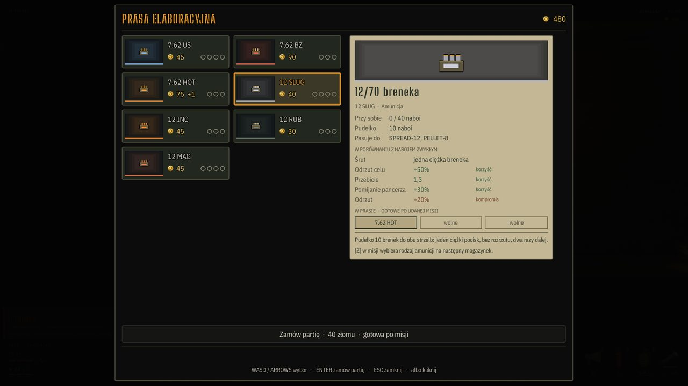
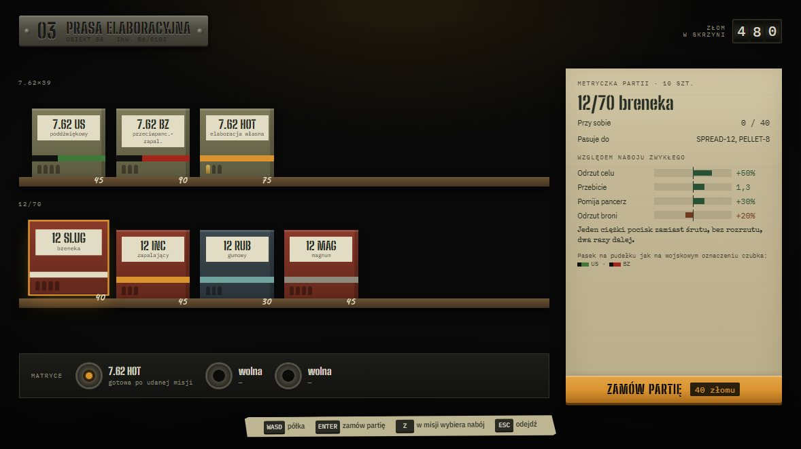
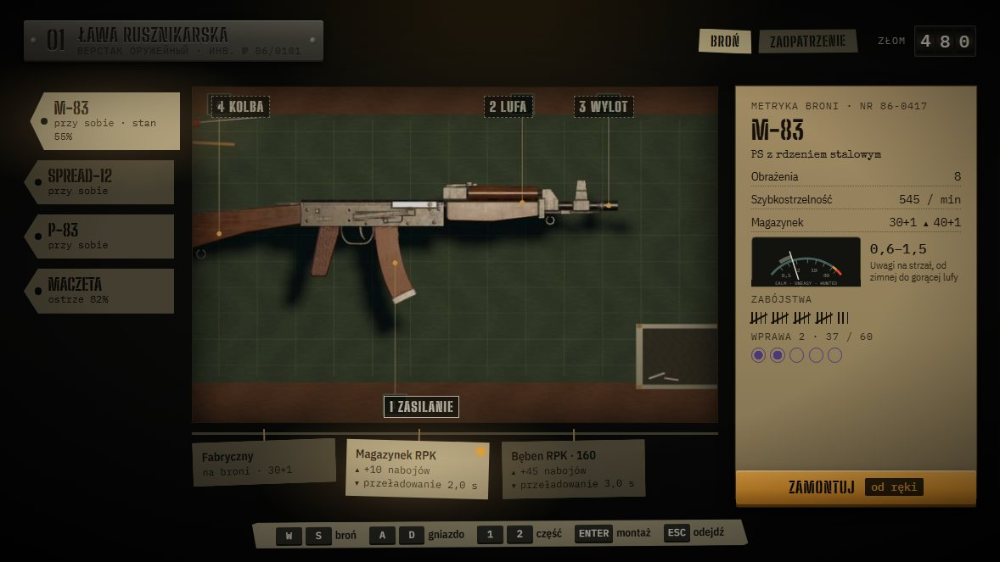
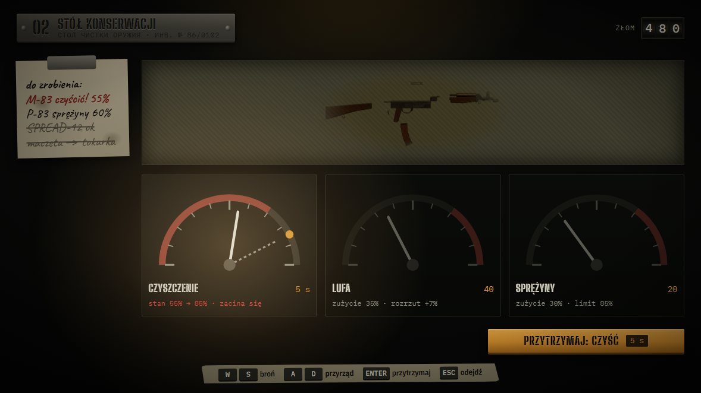
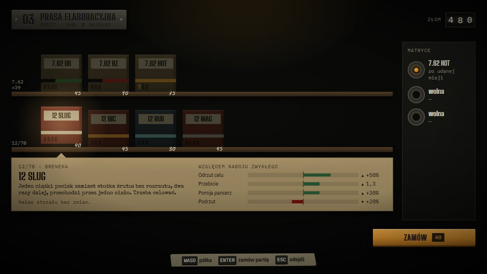
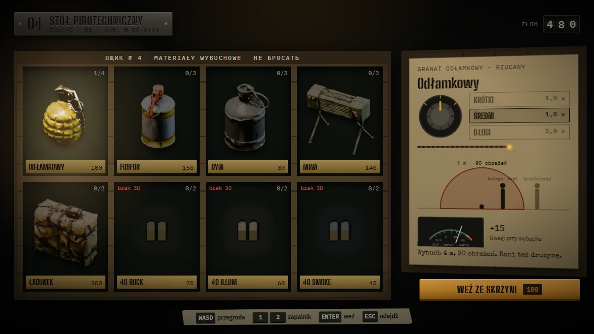
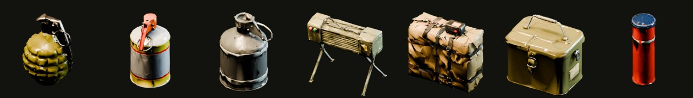
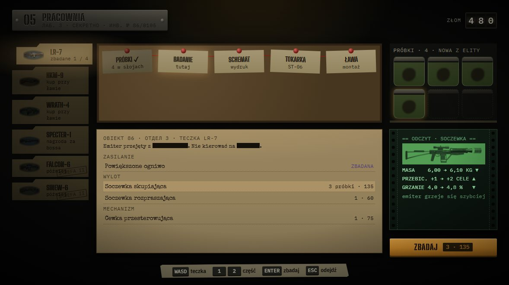
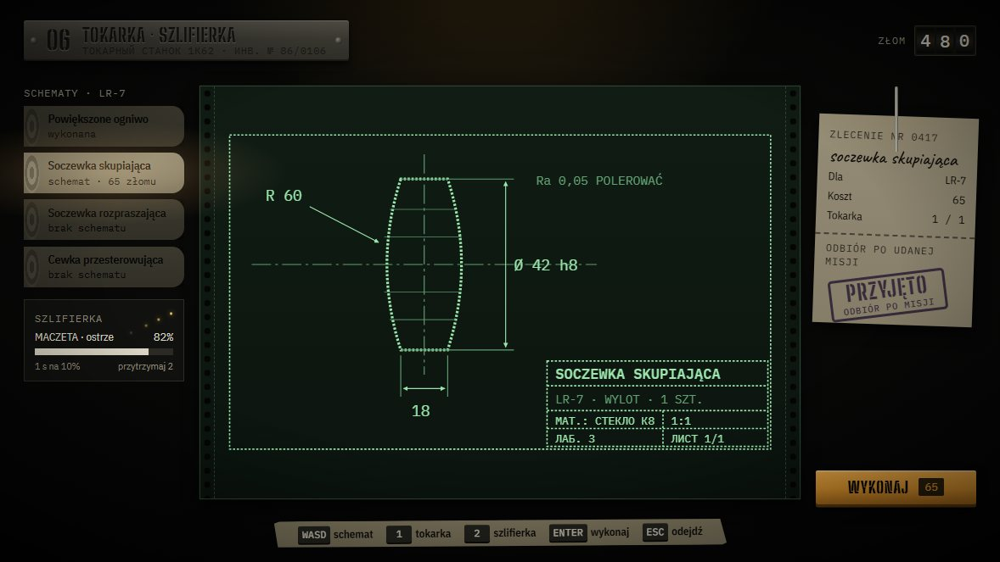
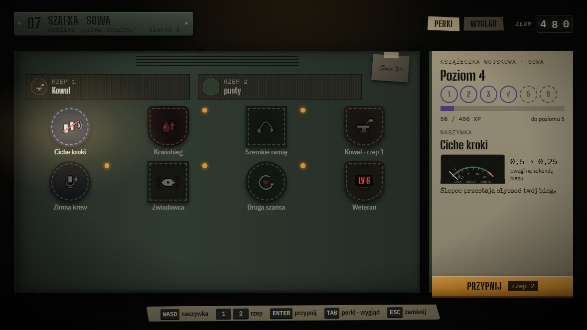

# Karty stanowisk Kryjówki — plan

Status: **plan z 2026-10-28 (main 1.7.412, 71e4aa6; zrzuty z 1.7.413, gałąź #505)**, nic nie wdrożone. Zmienia się tylko
prezentacja kart siedmiu stanowisk (`workshop_ui.gd`); logika, serwer, `Scrap.*` i dane zostają. Makiety i rendery w
[`docs/station_cards/`](docs/station_cards/). Decyzje D1–D4 podjęte 2026-10-28 (§9): D1a, D2a, D3a, D4a — E0 i E1 przed playtestem,
E2–E5 po nim. **E0 wdrożony w 1.7.414** (`tools/bake_items.gd`, `art/item_renders/`, `ItemIcon.RENDERS`). **E1 wdrożony w 1.7.415** (`station_kit.gd`, `station_noise.gd`, `vu_meter.gd`, nocny papier, nazwy §4.8) z trzema odstępstwami: zamiast dzielić cały `workshop_ui.gd` nowe elementy są w osobnych plikach (podział zrobiony po E5: `scripts/stations/` — supply, service, lab, locker; `workshop_ui.gd` z ok. 3970 do ok. 2740 linii, stan panelu i ława zostają w nim); papier wszystkich kart to akta (`DOSSIER`), a wydruk i kartka przychodzą z układami stanowisk w E3–E4; pieczątka bez daty gry. **E2 wdrożony w 1.7.416** (`station_supply_art.gd`: regał, etykieta partii, matryce, skrzynia, pokrętło, lont, schemat wybuchu; nawigacja po położeniu kafli). **E3 wdrożony w 1.7.417** (`station_service_art.gd`: przyrządy z manometrem, kartka do zrobienia, przytrzymanie czyszczenia; drzwi szafki, książeczka z pieczątkami, naszywki, rzepy, wiersz biegu i VU krzyku). **E4 wdrożony w 1.7.418** (`station_lab_art.gd`: korek z łańcuchem, słoje reagujące na dźwięk, akta z zaczernieniami, wydruk odczytu; rysunek części, zlecenie na szpikulcu, rulony, szlifierka z iskrami). **E5 wdrożony w 1.7.419** (`gunsmith_panel.gd`: metryka z VU magazynka, kreskami zabójstw i kółkami wprawy; zawieszki; szablony gniazd na przyciemnionej macie). Poprawki z przeglądu planu (2026-10-28): VU na karcie w skali HUD (§5a), nazwy statystyk z `ui.csv` (§4.8).

## 1. Cel

Karty ławy, stołu konserwacji, prasy, stołu pirotechnicznego, pracowni, tokarki i szafki mają przestać wyglądać jak jeden
sklepowy szablon i stać się częścią nocnego bunkra: każda karta to zbliżenie przedmiotu, który stoi przy znaczniku stanowiska
(modele z #440–#446), w palecie i z sygnałami tej gry — hałas, ciemność, światło lampy, coś, co słucha.

Po co: przed playtestem warsztat jest najdłużej oglądanym ekranem poza misją, a dziś to siatka kafli 150×46 z papierową kartą.
GDD §16.0a nie pozwala dokładać systemów warsztatu przed Gate 0 — ten plan ich nie dokłada, zmienia tylko to, jak wyglądają.

## 2. Stan obecny (z kodu i zrzutów 1.7.413)

| Obszar | Fakt | Gdzie |
|---|---|---|
| Układ | 6 z 7 stanowisk: siatka 2 kolumn kafli `CardTile`, papierowa karta po prawej, szeroki pasek akcji na dole | `workshop_ui.gd` `_make_tile`, `_build_detail` |
| Kafel | ten sam prostokąt dla granatu, naboju, broni w pracowni i perku; ikona 2D w kolorowej ramce | `CardTile`, `ItemIcon`, `PerkIcon` |
| Papier | `UiTheme.PAPER #c3b795`, luminancja ok. 0,47; zajmuje do 1/3 ekranu | `ui_theme.gd` |
| Reguła nocy | papier notatek po zmroku ma luminancję tła ≤ 0,3 („jasny papier świeciłby jak ekran”) | `note_palette.gd`, `tools/test_note_contrast.gd` |
| Materiały notatek | `DOSSIER` (maszynopis), `PRINTOUT` (wydruk z radia, zielony na ciemnym), `SCRAWL` (kartka odręczna) | `note_palette.gd` |
| Hałas przedmiotów | granat +15 Uwagi (`N_GRENADE`), mina +10, ładunek +20, fosfor +3, dym +2, skaner 1/s | `noise_manager.gd`, `throwables.gd` |
| Hałas broni i amunicji | M-83 0,6–1,5 na strzał (`n_min`/`n_max`), US ×0,85, z tłumikiem ×0,5; bieg 0,5/s, Ciche kroki ×0,5 | `weapons.gd`, `ammo.gd`, `perks.gd` |
| Progi Uwagi | niepokój 40, przebudzenie 60, uśpienie 30 (Nocny Dyżur je zmienia) | `NoiseMgr.*_THRESHOLD`, `NightShift` |
| Wygaszanie Uwagi | 4/s w ciszy, 1,5/s przez 1,5 s po każdym hałasie (`_apply` odnotowuje aktywność); bieg 0,5/s jest mniejszy od wygaszania, więc sam nie podnosi poziomu | `noise_manager.gd` `DECAY_*`, `player.gd` |
| VU w HUD | `VuMeter` — klasa wewnętrzna `hud.gd`, skala liniowa 0–100 Uwagi, strefy z `NoiseMgr` / `NightShift`, wskazówka = bieżący poziom | `hud.gd:147` |
| Nazwy statystyk | `Recoil` → „Odrzut” (`cam_kick`, `recoil`), `Knock-back` → „Odrzut celu” (`knock`); perk mówi „podrzut” („Przeładowanie, dobycie i podrzut”) — dwa odrzuty na jednej karcie amunicji (SLUG) | `translations/ui.csv`, `workshop_ui.gd` `AMMO_FIELDS` |
| Zdarzenia Kryjówki | generator przygasa w burzy; pukanie do D-7 (`knock_flash`, czerwony pas pod drzwiami) | `view3d.gd`, `hub_prop.gd` |
| Modele przedmiotów | `art/items3d`: frag, phos, smoke, mine, charge, ammo, flare (i inne); **brak** amunicji 40 mm | `art/items3d/*.glb` |
| Portrety z modeli | wrogowie i stroje już mają rendery z 3D | `tools/bake_portraits.gd`, `tools/bake_look_portraits.gd` |
| Cyrylica w krojach | ma ją tylko IBM Plex Mono i Caveat; Big Shoulders Stencil, Special Elite i Plex Sans Condensed nie | `art/fonts/*` (sprawdzone) |
| Najmniejszy tekst | UI_PLAN: min. 12 px etykiety, 14 px tekst przy 720p | `UI_PLAN.md` |

## 3. Przegląd pierwszej propozycji

Pierwsza wersja (v1) dała każdemu stanowisku metaforę, ale wyszedł z niej przytulny warsztat z gry o craftingu. Uwagi, od
najważniejszych:

1. **Papier świeci w nocy** — v1 i dzisiejsze karty łamią regułę nocnej palety z §2. → Tylko trzy materiały notatek w palecie nocnej.
2. **Nie widać hałasu** — filar 2 GDD i znak firmowy UI (VU-metr z UI_PLAN) sprowadzone do słowa „wybuch”. → VU-metr na karcie.
3. **Brak grozy** — karty nie reagują na burzę ani na pukanie do D-7. → Ciemność, zdarzenia Kryjówki, próbki, które słuchają.
4. **Płaskie ikony 2D** na nowych fakturach, choć gra jest „tylko 3D” i ma modele przedmiotów. → Rendery modeli (etap E0).
5. **Wybór w pomarańczowej ramce** i lampa użyta dwa razy (wybór i przycisk). → Światło jako kursor.
6. **Ten sam podział** w 6 z 7 makiet: lista po lewej, papier po prawej. → Kompozycja wynika z przedmiotu.
7. **Brak różnicy bunkier / oddział** — oddział jest polski, Obiekt 86 radziecki. → Tabliczki radzieckie i oddziału.
8. **Za drobny tekst** (10–11 px przy 720p). → Etykiety ≥ 1 % szerokości ekranu (12,8 px przy 720p).
9. **Kolory spoza palety** (fiolet jako czwarty akcent, ozalid) i brak stanów przycisku. → Fiolet tylko jako tusz, 4 stany.

## 4. Zasady

1. **Jedna metafora na stanowisko**, wzięta z modelu przy znaczniku. Karta to zbliżenie tego stołu.
2. **Każdy ozdobnik niesie dane**: pasek na pudełku = rodzaj naboju, długość lontu = czas zapalnika, słój = próbka,
   kreska na metryce = zabójstwo. Ozdobnik bez danych odpada.
3. **Noc**: dokumenty tylko w materiałach z `note_palette.gd`; jaśniej tylko tam, gdzie pada lampa.
4. **Kroje w swoich rolach**: stencil w nagłówkach i na tabliczkach, Plex w tekście roboczym, Special Elite na maszynopisie,
   Caveat tylko na kartkach odręcznych. Cyrylica tylko w Plex Mono.
5. **Krew racjonowana**: czerwień tylko dla zagrożenia (zacięcia, brak złomu, blokada). Lampa = wybór i akcja, mech = gotowe.
6. **Bez łupowych rzadkości**: w grze nie ma rzadkości przedmiotów, więc nie ma złotych i fioletowych ramek.
7. **Ruch tylko przy zdarzeniu** (pieczątka, bęben licznika, pokrętło, wysunięcie pudełka); wszystko wyłącza „Reduce effects”.
8. **Nazwy statystyk tylko z `ui.csv`**, te same na kartach, w HUD i w perkach. Makieta prasy ma „Podrzut”, którego gra nie używa;
   w E1 zamiast tego: `Knock-back` → „Odepchnięcie” (jak już istniejące „Prędkość odepchnięcia”), `Recoil` zostaje „Odrzut”, a perk
   „…i podrzut” → „…i odrzut”. Zmiana tylko w kolumnie `pl`, w całym UI naraz.

## 5. Wspólny korpus (wszystkie stanowiska)

| Element | Opis | Szkic w Godot |
|---|---|---|
| Tabliczka znamionowa | nitowana blacha: numer ST-0x, nazwa, drugi wiersz cyrylicą dla sprzętu bunkra (`ПРЕСС · ИНВ. № 86/0103`, tokarka `1К62`); szafka ma polską tabliczkę oddziału w zieleni munduru | `StationPlate`, StyleBoxTexture 9-slice |
| Licznik złomu | bęben jak w liczniku mechanicznym; wydatek obraca cyfry, brak złomu = czerwony błysk i drgnięcie | rozwinięcie `_tick_wallet` (#501) |
| Dźwignia akcji | jedyny element w kolorze lampy; nazwa czynności i cena; przytrzymanie tylko dla czynności w czasie (czyszczenie, ostrzenie) | `StationAction` |
| Stany przycisku | gotowe (lampa), brak złomu (szary, cena na czerwono), w toku (ciemny, „po misji”), do odbioru (mech) | tamże |
| Pieczątka | skutek akcji na dokumencie: ZAMÓWIONO, WYDANO, ZBADANO, PRZYJĘTO; fioletowy tusz, data gry | `Stamp`, AnimationPlayer 0,4 s |
| Taśma sterowania | taśma maskująca z klawiszami w kształcie klawiszy | `KeyTape` ← `_controls_hint`, `Actions.key()` |
| Materiały | `DOSSIER` (akta: metryka, etykieta partii, karta w wieku skrzyni, teczka), `PRINTOUT` (odczyt pracowni, rysunek dla tokarki, perforacja), `SCRAWL` (lista do zrobienia, zlecenie, książeczka) | `UiTheme.note_palette()` |
| Światło jako kursor | wybrany przedmiot w snopie lampy, reszta pod ciemną nakładką; ceny i nazwy na tabliczkach zostają czytelne; ramka tylko w trybie wysokiego kontrastu | nakładka i gradient (`TextureRect`) w warstwie UI, bez świateł 2D |
| VU-metr hałasu | ta sama skala co HUD (liniowa 0–100 Uwagi, strefy z `NoiseMgr` / `NightShift`); igła = poziom po typowym użyciu od ciszy (§5a), cień = to samo bez zmiany; tylko gdy przedmiot zmienia hałas | `VuMeter` wydzielony z `hud.gd` do własnego pliku, wspólny dla HUD i kart |
| Zdarzenia Kryjówki | burza: przygasa tylko lampa generatora w świecie, karta nie (1.7.421 — skok jasności karty wyglądał jak migotanie); pukanie do D-7: papiery drgają, czerwony błysk od strony drzwi, napis dźwięku z kierunkiem | sygnały z `view3d` / `hub_prop` |

### 5a. VU na karcie — skala i wskazówka (poprawka z przeglądu)

Pierwsza wersja planu dawała kartom skalę logarytmiczną 0,2–100 i wskazówkę z przyrostem jednego zdarzenia (granat „+15”) na tle
stref 40/60. To dwa błędy: na skali log strefy 40 i 60 lądują przy samym końcu łuku (wygląd HUD, inna skala), a strefy dotyczą
poziomu Uwagi, nie przyrostu. Dlatego:

- **Skala jak w HUD**: liniowa 0–100, strefy z `NoiseMgr` (z Nocnym Dyżurem). Gracz czyta kartę tak samo jak róg ekranu.
- **Wskazówka = poziom od ciszy po typowym użyciu**, liczony z danych i wygaszania 1,5/s (§2), nie wpisany ręcznie:
  - broń i amunicja: jeden magazynek ciągłym ogniem (`n_min`→`n_max` z `heat_gain`, `cooldown`, `mag`); M-83 ok. 31, z US ok. 26,
    z tłumikiem ok. 13 (szacunek z danych 1.7.412);
  - przedmioty rzucane i ładunki: jeden przedmiot (granat 15, mina 10, ładunek 20) i obok liczba „ile naraz do niepokoju”
    (granat: 3 = 45; rzucane co 2 s już tylko ok. 36);
- **Cień** = to samo bez zmiany (zwykły nabój, broń bez tłumika); bez pasma, bo nagrzewanie jest już w wyniku.
- **Bez VU**, gdy na poziomie nic nie widać: bieg (0,5/s) nie przebija wygaszania, więc Ciche kroki i ciężar ekwipunku dostają
  wiersz z mnożnikiem (▼ bieg ×0,5), nie igłę na zerze.
- Funkcja licząca poziom (`StationNoise.level_after(...)`) jest czysta i ma test w E1, żeby karta nie rozjechała się z `NoiseMgr`
  po zmianie stałych.

## 6. Stanowiska

Makiety (HTML, nie Godot) z danymi z gry; zużycie, zabójstwa i wprawa na ławie są przykładowe.

### ST-01 Ława rusznikarska — metryka po zmroku

- Broń zostaje na macie 3D (#472), przyciemnionej; gniazda jako szablony na macie. Bronie i części to zawieszki na hakach.
- Prawa karta to **metryka broni** (`DOSSIER`): parametry, VU z poziomem po magazynku (§5a), zabójstwa kreskami po pięć, wprawa kółkami.
- Na częściach korzyść i koszt ze znakami ▲▼ (`_part_delta`). Tłumik przesuwa igłę VU (M-83 ok. 31 → 13), stara zostaje jako cień.

### ST-02 Stół konserwacji — trzy przyrządy

- Prawa karta znika. Czyszczenie, lufa i sprężyny to trzy przyrządy z manometrem: czerwona strefa zacięć poniżej 70 %,
  kropka lampy na limicie `clean_cap`, cień igły pokazuje, dokąd dojdzie.
- Lista do zrobienia z `_refresh_service_todo` na kartce (`SCRAWL`) z plamami oleju. Płótno z rozłożoną bronią przyciemnione.
- Czyszczenie trwa w czasie (W0), więc przytrzymanie; igła jedzie razem z paskiem, na końcu pieczątka.

### ST-03 Prasa elaboracyjna — etykieta pod pudełkiem

- Regał (ammo_shelf z #441), półka na kaliber. Pasek na pudełku jak oznaczenie czubka: US czarny z zielonym, BZ czarny z czerwonym.
- Etykieta partii (`DOSSIER`) wisi pod półką z ząbkiem wskazującym wybrane pudełko; wiersze z `mods` w `ammo.gd` jako paski od zera.
- VU tylko przy naboju, który zmienia hałas (US: magazynek M-83 ok. 31 → 26); przy innych napis „hałas strzału bez zmian”. Matryce prasy pionowo, po prawej.
- Makieta ma wiersz „Podrzut”; w E2 nazwy jak w §4.8: „Odepchnięcie” (`knock`) i „Odrzut” (`cam_kick`).

### ST-04 Stół pirotechniczny — skrzynia i wieko

- Skrzynia z magazynu Obiektu 86 (napisy radzieckie na krawędzi), przegrody z **renderami modeli** pod lampą; 40 mm z ikoną i napisem „brak 3D”.
- Karta (`DOSSIER`) leży w otwartym wieku: pokrętło zapalnika (`Throwables.FUSES`, pad lewo/prawo), lont o długości czasu,
  schemat wybuchu w skali z sylwetką kolegi (granat rani drużynę), VU z poziomem po jednym przedmiocie i liczbą „3 naraz = niepokój” (§5a).
  Makieta ma jeszcze „+15” na tle stref — do zmiany w E2.

### ST-05 Pracownia — akta, wydruk i słoje

- Teczki broni po lewej, łańcuch `LAB_STEPS` na korku z czerwoną nicią, słoje z próbkami (nowa z elity świeci lampą).
- Teczka części to akta Obiektu 86 z zaczernieniami (miejsce na lore z taśm i notatek 1.0); odczyt części jako `PRINTOUT`.
- **Groza**: przy badaniu, pukaniu albo dźwięku ciemne kształty w słojach powoli obracają się w stronę źródła. Jedyny taki ruch w warsztacie.

### ST-06 Tokarka i szlifierka — rysunek z drukarki

- Schemat z pracowni jako wydruk (`PRINTOUT`): obrys części, wymiary, linia osiowa, tabliczka rysunkowa cyrylicą (laboratorium Obiektu 86).
  Jeden szablon dla wszystkich części: obrys z modelu plus wymiary.
- Zlecenie odręczne (`SCRAWL`) nabite na szpikulec, z pieczątką PRZYJĘTO. Schematy jako rulony; brak schematu = przygaszony rulon.
- Szlifierka: stan ostrza z `Profile.edge`, iskry tylko w trakcie ostrzenia.

### ST-07 Szafka osobista — rzecz oddziału

- Polska tabliczka oddziału, drzwi szafki (locker_row z #445): perki jako naszywki ze szwem, sloty jako paski rzepu,
  zdjęcie przyklejone taśmą (miejsce na portret z #502).
- Książeczka wojskowa (`SCRAWL`) z pieczątkami poziomów; perk zmieniający hałas ma wiersz z mnożnikiem (Ciche kroki: ▼ bieg ×0,5),
  bez VU — bieg nie podnosi poziomu (§5a).
- Stany jak dziś: dostępny, założony, nowy (kropka lampy z `Profile.is_new`), zablokowany (w folii, LV na czerwono).

## 7. Etapy (jedno stanowisko na PR)

| Etap | Zakres | Nowe elementy | Sprawdzenie |
|---|---|---|---|
| E0 | Rendery przedmiotów | `tools/bake_items.gd` na wzór `bake_portraits.gd`: modele z `art/items3d` pod lampą stanowiska, przezroczyste tło, 2× dla 4K; lista braków (40 mm) | porównanie z ikonami w skrzyni i na półce |
| E1 | Korpus na 7 stanowiskach | §5 w całości; podział `workshop_ui.gd` (ok. 3000 linii) na widoki stanowisk; `VuMeter` z `hud.gd` do własnego pliku; nazwy z §4.8 w `ui.csv` | `test_note_contrast.gd` rozszerzony o papier stanowisk, `--uifittest` 1280×720 PL/EN, `--workshoptest`, test `StationNoise.level_after` kontra `NoiseMgr` |
| E2 | Prasa i pirotechnika | półka z etykietą, matryce; skrzynia z renderami, wieko, pokrętło, schemat wybuchu | pad: światło za fokusem, pokrętło lewo/prawo |
| E3 | Konserwacja i szafka | przyrządy z manometrami; tabliczka oddziału, naszywki, książeczka | `--shotclean`, `--shotperks`, `--cabinettest` |
| E4 | Pracownia i tokarka | akta z zaczernieniami, wydruki, słoje; rysunek, szpikulec, szlifierka | `--shotlab`, `--shotlathe` |
| E5 | Ława | metryka z VU, przyciemniona mata, zawieszki | `tools/workbench_qa.gd` |

Kolejność wg D4a: E0 i E1 przed playtestem (GDD §23.3), E2–E5 po nim. Każdy etap kończy się zrzutami `--shotws*` (z `override.cfg` i `custom_user_dir`, żeby nie ruszać profilu gracza) i można
po nim przerwać, gdyby playtest (GDD §23.3) schował część stanowisk.

## 8. Ryzyka

- **Czytelność na 720p** — tekst roboczy w Plex ≥ 14 px; stencil, maszynopis i pismo odręczne tylko w krótkich napisach.
  Ciemny atrament na nocnym papierze ma mały kontrast dla koloru, więc zysk i koszt mają też znak ▲▼.
- **Przesyt** — na ekranie jedna metafora i jeden ciepły element. Jeśli zrzut wygląda jak scenografia, tniemy ozdoby, nie dane.
- **Rendery a ikony** — rendery przedmiotów zmieniają też inne miejsca, gdzie dziś są ikony 2D (zaopatrzenie ławy, HUD);
  E0 dotyczy tylko kart stanowisk, reszta osobno.
- **Koszt grafiki** — faktury z generatora Pythona w `tools/`, bez ręcznego malowania (zasada repo).

## 9. Decyzje (podjęte 2026-10-28 — wybrane warianty oznaczone ✅)

- **D1. Cyrylica na tabliczkach** — ✅ a) drugi wiersz cyrylicą tylko na sprzęcie bunkra (w IBM Plex Mono); b) wszystko po polsku.
- **D2. Reakcja słojów na dźwięk** — ✅ a) tak, tylko w pracowni, wyłączana przez „Reduce effects”; b) bez ruchu.
- **D3. Amunicja 40 mm** — ✅ a) zostaje ikona do czasu modeli (w E0 lista braków); b) modele (Meshy / Blender) w E0.
- **D4. Kolejność** — ✅ a) E0 i E1 przed playtestem, E2–E5 po nim (wyniki playtestu mogą zmienić albo skreślić te etapy);
  b) całość przed playtestem.
