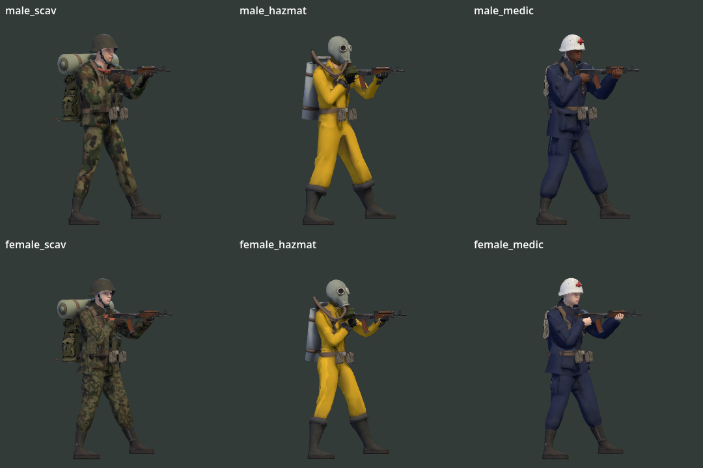

# Jakość postaci — Dead Air ’87

Data: 2026-10-24. Wersja gry: **1.7.367**, checkout `657b8fb`, gałąź `fix/weapon-workshop-flow`.

## Wynik

Postacie mają poprawną bazę techniczną i rozpoznawalne stroje. Do dopracowania pozostają przede wszystkim ubrania, chwyt pistoletu i czytelność detali w małej skali. Największy potwierdzony problem wizualny dotyczy medyczki: przy celowaniu w górę widać przenikanie ubrania i odsłonięcie spodniej warstwy w okolicy pachy. Nie wykryto problemu blokującego uruchomienie modeli lub testów.

Ocena artystyczna jest subiektywna: obecny zestaw nadaje się do testów gry, ale zbliżenia ujawniają nierówny poziom wykończenia. Nie jest to ocena gotowości całej gry do wydania.

## Zakres i metoda

- Wszystkie **6** domyślnych postaci graczy MPFB: Scavenger, Hazmat i Medic, warianty męskie i żeńskie. Zestaw zapasowy Tripo nie jest podstawą oceny.
- Oficjalny Godot **4.7.2** (`ed1daf0bf`), Windows, **Forward+ / Vulkan na RTX 3080**. Podglądy używają faktycznego `Char3D`, jego materiałów i IK. Osobno wykonano zrzuty normalnej gry w kryjówce i na nocnej misji.
- Blender **5.2.2 LTS**: import gotowych GLB, sprawdzenie UV, wag, skończoności współrzędnych i zdegenerowanych ścian. Modele nie były przebudowywane.
- Istniejące testy proporcji i punktów celowania na źródłach, z odizolowanymi danymi użytkownika.
- Próbka ruchu: 45 klatek porównania biegu, startu/stopu i biegu tyłem; oglądano kolejne fazy. Podgląd porównuje pozy proceduralne, surowy klip i wariant klip + IK. Nie stanowi pełnego testu wszystkich animacji.
- Uzupełniająca kontrola czterech wrogów: Wołek, Ślepiec, Podsłuchacz i Stalker w porównaniu póz chodu. Nie audytowano wszystkich bossów, ataków i wariantów przeciwników.

**Pewność wysoka:** stan plików, materiałów, testów oraz uchwycone artefakty. **Średnia:** artystyczna czytelność i odbiór ruchu. Wpływ na wydajność słabszych komputerów i ocenę zewnętrznych graczy pozostaje niezmierzony.

## Stan wdrożenia

| Element | Stan potwierdzony |
|---|---|
| MPFB, sześć wariantów | Zaimplementowane; `Char3D.charset = "mpfb"`, wybór plików w `set_look` |
| Model w świecie 3D | Zaimplementowane; `view3d._make_rig` przenosi model i broń do świata i wyłącza podglądowe viewporty |
| Materiały, palety, krew | Zaimplementowane w `char3d.gd`; nie wszystkie ubrania zawierają komplet map |
| Retargeting klipów i IK | Zaimplementowane; klipy bazowe oraz proceduralne dopasowanie rąk i części stanów |
| Szyte ubrania medyków | Częściowo: generator ma kurtkę/spodnie i opcję `--sewn` dla mężczyzny; żeński zestaw w `cloth_garments.py` zawiera tylko buty. Sama konfiguracja męskiego zestawu nie dowodzi zastosowania go w aktualnym GLB |
| Import LOD | Konfiguracja `meshes/generate_lods=true` dla wszystkich sześciu modeli. W tym audycie nie zmierzono wyboru poziomów LOD podczas gry |
| Medic outfit v2 | Lokalny dokument projektu opisuje dalsze prace; nie traktowano go jako wdrożonej funkcji |

Źródła: [wybór modeli](../../prototype/scripts/char3d.gd#L620), [integracja ze światem](../../prototype/scripts/view3d.gd#L627), [stroje](../../prototype/scripts/look.gd#L10), [generator medyków](../../prototype/tools/char_mpfb.py#L155), [zestawy szytych ubrań](../../prototype/tools/cloth_garments.py#L1704).

## Ustalenia i priorytety

### P2 — ubranie medyczki przenika przy uniesieniu ramion

**Fakt:** przy M-83, celowaniu 50° i widoku bocznym widać odsłoniętą spodnią warstwę pod podniesionym ramieniem; okolice rękawa/barku i pasków również wymagają dopasowania. Zrzut pokazuje model z rzeczywistym IK, a nie nieruchomą pozę eksportową.

**Rekomendacja:** przygotować dopasowaną kurtkę i spodnie dla medyczki w istniejącym pipeline ubrań, skontrolować wagi barków/pach i maskowanie ciała pod tkaniną. Zachować obecną tożsamość oraz rig. Zatwierdzać podglądy przy 0°, ±50°, kucaniu i przeładowaniu, z obu stron.

Dowód: [zbliżenia rąk i ubrania](images/character-hands-medic-1.7.367.png), [konfiguracja żeńskiego modelu](../../prototype/tools/char_mpfb.py#L170).

### P2 — materiały ubrań tracą relief

**Fakt:** eksportowane kurtki i spodnie obojga medyków nie mają `normalTexture` ani mapy metallic/roughness. Podobnie jest z głównym ubraniem Hazmatów i żeńskiego Scavengera; męski Scavenger ma normalne ubrania. Generator przy pełnym przemalowaniu odłącza węzły `NORMAL_MAP`, aby usunąć wytłoczone napisy. Shader bez mapy ORM ustawia `ROUGHNESS = 0.85`. Szczegóły odzieży opierają się więc głównie na geometrii i kolorze, co w zbliżeniu daje gładkie, nierówne wykończenie.

**Rekomendacja:** przygotować neutralne normalne tkaniny i szwów oraz mapę roughness. Usuwać niepożądane oznaczenia selektywnie przy wypalaniu tekstur; zachować pozostały relief. Rozdzielić właściwości tkaniny, gumy, skóry i metalu. Porównywać wynik również w docelowej wielkości postaci, aby szczegóły nie zamieniały się w szum.

Dowód: [dane z GLB](2026-10-24-character-quality-data.json), [odłączanie normalnych](../../prototype/tools/char_mpfb.py#L1426), [shader materiału](../../prototype/scripts/char3d.gd#L112), [konwersja materiałów](../../prototype/scripts/char3d.gd#L545).

### P2 — chwyt P-64 jest świadomym uproszczeniem

**Fakt:** lewa dłoń podpiera stopkę chwytu od dołu. `_left_hold` jawnie przesuwa jej cel o `-0.105 m` i komentarz wyjaśnia tę decyzję otwartymi dłońmi modelu. Zbliżenie wygląda jak luźne podparcie zamiast obejmowania ręki strzelającej. To zachowanie zaprogramowane, nie wykryty błąd sieci lub celowania.

**Rekomendacja:** osobny cel i orientacja lewej dłoni dla chwytu pistoletu oraz odpowiednia poza palców. Sprawdzić wszystkie sześć modeli i kąty celowania bez zmiany punktu wylotu używanego przez rozgrywkę.

Dowód: [podgląd P-64](images/character-hands-medic-1.7.367.png), [`_left_hold`](../../prototype/scripts/char3d.gd#L1054), [`_pose_arms`](../../prototype/scripts/char3d.gd#L1508).

### P2 — obecne testy nie potwierdzają jakości wizualnej medyków

**Fakt:** test `_hands` obejmuje Scavengerów i Hazmatów, pomija oboje medyków. Sprawdza zasięg wierzchołków względem kości dłoni (limit 25 cm) i zgięcie palca. Nie mierzy styku dłoni z bronią ani przenikania ubrania. Test proporcji szkieletu obejmuje wszystkie sześć modeli.

**Rekomendacja:** rozszerzyć kontrolę deformacji na medyków; do oceny styku i ubrania stosować stały zestaw podglądów. Test pozytywny proporcji nie zastępuje oceny wizualnej.

Dowód: [`test_proportions._hands`](../../prototype/tools/test_proportions.gd#L77).

### P3 — koszt i drobna higiena siatek

**Fakt:** źródłowe modele mają 29,8–41,2 tys. trójkątów oraz 11–16 powierzchni/materialów. W Blenderze nie wykryto nieważonych wierzchołków ani brakujących UV; znaleziono po jednej niemal zerowej ścianie u żeńskiego Hazmata i Scavengera. Ich wpływ na obraz nie został potwierdzony.

**Rekomendacja:** najpierw zmierzyć rzeczywiste wywołania rysowania, czas renderowania i działanie LOD przy czterech graczach. Dopiero na tej podstawie scalać materiały, atlasować tekstury i upraszczać niewidoczne fragmenty. Usunąć drobne ściany przy następnym kontrolowanym eksporcie. Audyt nie dowodzi, że postacie są obecnym wąskim gardłem.

## Dane modeli

Liczby dotyczą najwyższej geometrii źródłowych GLB, bez broni i bez kosztu dodatkowych przebiegów renderowania.

| Model | Trójkąty | Powierzchnie / materiały | Kości skinu | Plik MB |
|---|---:|---:|---:|---:|
| male_scav | 37 486 | 14 | 52 | 4,68 |
| female_scav | 41 216 | 16 | 53 | 5,35 |
| male_hazmat | 29 807 | 11 | 52 | 3,24 |
| female_hazmat | 30 128 | 11 | 52 | 3,13 |
| male_medic | 30 937 | 13 | 52 | 3,99 |
| female_medic | 30 978 | 14 | 52 | 4,19 |

Obrazy osadzone w tych modelach mają rozdzielczości 512² i 1024². Brak animacji wewnątrz plików postaci jest zamierzony: klipy są w osobnych GLB i retargetowane przez `char_clips.gd`.

## Czytelność i ruch

Hazmat ma najsilniejszy znak rozpoznawczy: żółty kombinezon, maskę i butlę. Medyk jest rozpoznawalny po białym hełmie i czerwonym krzyżu; z boku granatowy tułów ma mniej wyróżników. Scavenger pasuje do otoczenia i ma czytelny ekwipunek, ale ciemny kamuflaż traci szczegóły na tle lasu.

W nocnym ujęciu przy zwykłym zoomie sylwetki pozostają widoczne w lokalnym świetle; detale stroju są znacznie mniej czytelne niż na podglądzie. To pojedyncze ujęcie, nie dowód czytelności wszystkich sytuacji. Kolejne testy powinny obejmować czterech ludzi, podobne stroje, ruch i ograniczone światło.

Próbka biegu pokazuje działające klipy i dopasowanie broni przez IK. Różnice w postawie, długości kroku i pracy tułowia wymagają oceny w ruchu; nie stwierdzono na tej podstawie błędu wszystkich animacji. Podgląd proceduralny z obrysem służy kontroli póz — wygląd świata gry oceniono oddzielnie.

[Ruch: porównanie wariantów](images/character-run-1.7.367.gif) · [kryjówka, zbliżenie 2×](images/character-hub-1.7.367.png) · [nocna misja, zwykły zoom](images/character-night-1.7.367.png).

W próbce przeciwników Wołek ma wyraźnie masywną sylwetkę, Ślepiec jest drobniejszy, Podsłuchacz i Stalker bardziej smukli. Ich odbiór w ciemności wymaga osobnego sprawdzenia. [Podgląd czterech wrogów](images/character-enemies-1.7.367.png).

## Walidacja i ograniczenia

- `test_proportions.gd`: **102** pozytywne sprawdzenia, **PASS**, kod 0.
- `test_aim_points.gd`: **PASS**, kod 0.
- Blender: 6 GLB zaimportowanych, 0 nieważonych wierzchołków, 0 braków UV, 0 nieskończonych współrzędnych.
- Podglądy i ujęcia gry: zapisane na RTX 3080 w Forward+; brak `SCRIPT ERROR` i `Parse Error`.
- W rozbudowanych narzędziach podglądu wystąpiły komunikaty `Attempted to free invalid ID` podczas zamykania, już po zapisaniu obrazów. Procesy zakończyły się kodem 0; nie uznano tego za dowód poprawnego sprzątania zasobów. Ujęcia świata nie zgłosiły tych błędów. Wymaga to odrębnej diagnostyki, jeśli występuje przy częstym otwieraniu/zamykaniu podglądu.
- Nie wykonano oceny mimiki, całego zestawu przeładowań, wszystkich animacji powaleń i revive, jakości każdej palety, wydajności na słabszym GPU ani testów wieloosobowych czytelności.

## Następny krok

Pierwszy, ograniczony zakres poprawki: **ubranie medyczki oraz normalne/roughness strojów medyków**, z kontrolą chwytu P-64 i podglądami sześciu modeli. Potem sprawdzić czytelność czterech graczy w zwykłym zoomie i zmierzyć koszt renderowania. Obecny rig i pipeline pozwalają przeprowadzić te prace na istniejących modelach.

Audyt dodał wyłącznie raport, dane i zrzuty. Nie zmieniono modeli, generatorów, mechaniki, wersji gry ani konfiguracji CI.

## Wdrożenie po audycie

Powyższe ustalenia dotyczą wersji 1.7.367, sprzed zmian modeli. Poprawki mundurów medyków i chwytu P-64 w wersji 1.7.368 opisuje [raport wdrożenia](2026-10-24-medic-polish.md).
