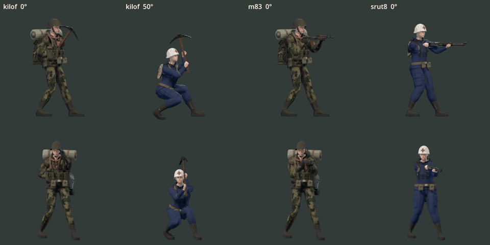
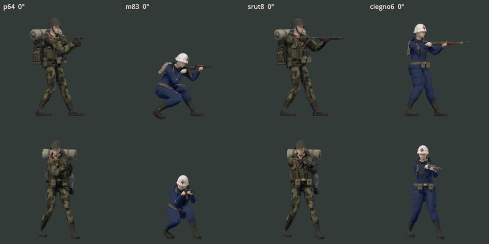

# Animacje walki TPP — poprawka 1.7.371

## Wynik

Wdrożono klipy pracy ciała na szkielecie MPFB, nakładane na istniejącą lokomocję w `AnimationTree`, oraz osobny zegar akcji. Kilof ma przygotowanie, rozpęd, kontakt w fazie 0,45, wybieg, powrót i przesuwający się chwyt. Strzał używa profili odrzutu w metrach/radianach. Przeładowanie porusza dłonią i rzeczywistymi częściami broni; pojedynczy nabój ma własny cykl.

Źródło animacji: [`bake_combat_anim.py`](../../prototype/tools/bake_combat_anim.py), [`combat.blend`](../../art_src/animations/combat.blend). To autorskie klipy kluczowane, bez wykorzystania zewnętrznego motion capture. Zapis Blendera zachowuje sześć akcji do dalszego ręcznego dostrajania. Generator tworzy GLB ze szkieletem i minimalną kotwicą siatki, bez tekstur postaci.

## Poprawki i dowody w kodzie

| Problem | Wdrożenie |
| --- | --- |
| Obserwator zaczynał zamach dopiero przy rozstrzygnięciu trafienia, 405 ms po lokalnym początku kilofa | `weapon_controller.gd::_begin_motion/_sync_motion` publikuje numer, rodzaj, broń, wariant, czas i fazę. `player.gd` replikuje `w_action/w_action_clock`. `weapon_view.gd` odtwarza bieżącą fazę ze snapshotu; skutek ciosu nie uruchamia animacji ponownie. |
| Zdalne przeładowanie powtarzało i cofało fazę sinusoidy czasu systemowego | `weapon_motion.gd::sample` przyjmuje rzeczywisty czas, odrzuca starsze numery, nie wznawia przerwanej akcji i ekstrapoluje brakujące snapshoty. Wydłużenie przeładowania taktycznego nie cofa fazy. |
| Trzy ruchy ręki podczas ładowania jednego naboju | `_begin_round` nadaje każdemu nabojowi nowy numer; `Char3D::_left_path("shell")` wykonuje jeden cykl. |
| Ruch bioder, barków i głowy był samą krzywą proceduralną | `CharClips` dodaje sześć klipów `combat_*` przez maskowane `AnimationNodeAdd2`. `_combat_action` wybiera zamach, przeładowanie lub rodzinę strzału; czas pochodzi z akcji, a ręce kończą pozycję przez IK. |
| Nakładka bioder podciągała stopy | Najpierw liczona jest lokomocja i jej cele stóp, potem nakładka walki. `_ground_hips` obniża biodra, gdy noga nie sięga podłoża; statyczne stopy mają stałą wysokość kostki. Nie dodano fizycznego kroku omijającego kolizję 2D. |
| Niski cios odginał nadgarstek | `_grip_shift` dla kilofa uwzględnia nie tylko zasięg ramienia, lecz także możliwy kierunek przedramienia względem chwytu. `_pickaxe_hand` przesuwa prowadzącą dłoń po trzonku. Krzywe Hermite’a zapewniają ciągłość prędkości między fazami. |
| Głowica kilofa schodziła pod podłoże i odbiegała od kierunku trafienia | `_pickaxe_strike` koryguje tor w oknie kontaktu i utrzymuje głowicę nad podłożem. Końcowe IK zachowuje kontakt obu dłoni. Korekta nie zmienia stożka, zasięgu ani obrażeń `Combat`. |
| Odrzut żądał cofnięcia karabinu o 12,27 cm, a srut8 o 34,36 cm | `weapon_motion.gd::RECOIL/recoil_at` ma osobne profile: amplituda M83 2,5 cm, P64 3,5 cm, srut8 4,5 cm, osobny kąt i czas wygaszania. Szybki impuls i tłumiony powrót nie zależą od FPS. Rozrzut i podrzut celowania pozostają w kontrolerze. |
| Magazynek i pompka były nieruchome | `weapon_parts_pose.gd` prowadzi magazynki, także zamontowane części zastępcze, za dłonią; porusza suwadłem i spustem. `gun_proc.py` wydziela pompkę i suwadło srut8, bez przesuwania lufy. Obraz i mapa normalnych mają takie same pozy części. |

## Walidacja

- **87 408 próbek dłoni: PASS.** Sześć wyglądów, dwanaście broni, postój/bieg/kucanie, oba kierunki, pięć kątów, pełny zamach, przeładowania, cykle i zwrot. Maksymalne zgięcie nadgarstka **80,36°**, łokcia **145,03°**, krok broni między klatkami **8,33 cm**. Kontakt dłoni i długości kości spełniają limity regresji.
- **261 kontroli animacji: PASS.** Odtwarzanie snapshotu, utrata/powtórzenie pakietu, przerwanie, nowy cykl naboju, odrzut przy 30/60/120 FPS, głowica kilofa, podparcie stóp, powrót magazynka i ruch pompki.
- Głowica kilofa: maksymalne odchylenie od kierunku celowania w fazie trafienia **11,12°** w sześciu wyglądach, dwóch postawach, pięciu kątach i obu kierunkach. Brak przejścia referencyjnej głowicy pod podłoże. Maksymalna zmiana wysokości statycznej stopy podczas ciosu **1,30 mm**. To pomiary punktu `muzzle` kilofa i kości, nie pełna analiza kontaktu wszystkich trójkątów siatki.
- **Rzeczywisty host–klient: 13/13 PASS.** Pierwsza zarejestrowana faza zamachu hosta **0,037**, wcześniejsza od trafienia w 0,45; przeładowanie rośnie bez cofania fazy. Jest to pomiar fazy w lokalnym teście ENet, nie gwarancja opóźnienia w Internecie.
- Proporcje/hitboxy: PASS. Tekstury po ponownym imporcie zachowują kompresję VRAM (`tex_vram.py --check`: 0 do poprawy).
- Podgląd Godot 4.7.2, Vulkan, RTX 3080: dwa powtarzalne nagrania poniżej, po 67 klatek, widok boczny i od strony lufy. Bez błędów skryptów renderującego narzędzia.
- **Pełne testy broni: 379/379 PASS.** Punkty celowania: PASS, maksymalne odchylenie spokojnej lufy modelu od wylotu rozgrywki **0,47 px** (limit 1,5 px).

W czasie pierwszego pełnego przebiegu test zakupów zaopatrzenia natrafił na granicę limitera duplikatów. Test używał timera gry, a limiter czasu rzeczywistego. Oczekiwanie testu zostało przełączone na zegar monotoniczny z zapasem; zasady zakupów nie zmieniły się.

Pomiar CPU samego `Char3D.update` (male_scav, pięć pozycji, 240 klatek na pozycję, bez renderowania): mediana po poprawce **0,187–0,626 ms**, 95. percentyl **0,237–0,766 ms** na tej maszynie. To nie jest pomiar FPS gry ani wynik dla czterech graczy na słabszym sprzęcie.

## Podgląd po poprawce

Odtworzenie: `godot --path prototype -s tools/shot_combat3d.gd -- --out=/tmp/combat`, następnie wariant z `--reloads`. Broń i ciało korzystają z tych samych klipów/profili co gra. Nagrania nie zawierają przeciwników ani fizycznych pocisków.

## Zakres i dalsza kontrola

Zmiana dotyczy widoku trzecioosobowego na misji. Osobny rig FPP strzelnicy zachowuje swoje klipy i korzysta z tego samego kontrolera amunicji. Nie wprowadzono nowego szkieletu, zmian hitboxów, zależności ani logiki obrażeń po stronie widoku. Nowe dane torów są zasobem GDScript z `preload`, więc trafiają do eksportu gry bez dodatkowego filtra JSON.

Pewność: wysoka dla czasu akcji, kontaktu dłoni, podparcia i ograniczeń geometrycznych w sprawdzonej macierzy. Naturalność oceniono również na renderach, ale nie ma jednej wersjonowanej normy zapewniającej ją automatycznie. Następna kontrola artystyczna powinna objąć dłuższą rozgrywkę czterech postaci, szybkie przejścia i czytelność ruchów w docelowej odległości kamery. Nie deklarujemy walidacji każdego kontaktu palców ani każdej powierzchni wyposażenia.
