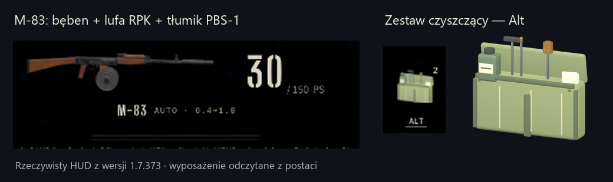

# HUD wyposażenia — 1.7.373

## Wynik

Główna ikona broni i miniatury slotów pokazują faktycznie zamontowane części postaci. Puste pole zestawu czyszczącego zastępuje model 3D płóciennego etui z wyciorem, szczotką, oliwiarką i szmatkami oraz przezroczysta ikona. Licznik i przygaszenie przy zerowym zapasie zachowują dotychczasowe działanie.



[Pełny zrzut gry](equipped-hud-1.7.373.png): M-83, bęben RPK, lufa RPK i tłumik PBS-1; zestaw czyszczący wybrany w slocie Alt. Zrzut z rzeczywistej sceny, renderer Forward+/Vulkan, 1280×720.

## Implementacja

- `prototype/scripts/hud.gd::_drive_weapons`: `WeaponController.fit_of(id)` i `notches_of(id)` są jedynym źródłem wyposażenia ikon, tak samo jak w `weapon_view.gd`. Odblokowane, ale niezamontowane części nie trafiają do podglądu.
- `equipped_gun_icon.gd::set_weapon`: podpis broń/montaż/nacięcia unieważnia obraz także po zmianie części tej samej broni. Opóźniony wynik poprzedniego zestawu jest odrzucany.
- `gun_preview.gd::compose`: używa wspólnego `GunModel.build`, tych samych modeli, punktów mocowania, wymiany komponentów oraz kodowania nacięć co postać. Kadrowanie uwzględnia narożniki pełnego modelu w przestrzeni kamery.
- `gun_preview.gd`: jeden viewport 768×256 renderuje kolejkę tylko po zmianie zestawu; wynik z mipmapami współdzielą sloty i główna ikona. Cache LRU ma limit 32 tekstur. Po wypieku model jest zwalniany, viewport wyłączany. Fabryczna broń bez nacięć używa istniejącej ikony.
- `prototype/tools/make_hud_models.py::cleankit`: powtarzalny model z własnej geometrii i materiałów PBR, bez nowych zależności ani zewnętrznych assetów. `bake_hud_icons.gd` wypieka `art/hud/cleankit.png`; korzysta z niej także kodeks przez `HudIcon.texture_of`.
- `input_setup.gd::_on_node_added`: sprawdzenie połączenia sygnału eliminuje błędy podwójnego `mouse_entered` podczas przenoszenia przycisków warsztatu.

## Weryfikacja

- `test_equipped_ui.gd`: **32 kontrole**, zgodność głównej ikony i slotu z postacią, podmiana części tej samej broni, przełączenie broni, wymiana magazynka/lufy, zachowana kolba, zamontowane trzy dodatki, wymiary modelu, niepusta ikona i zapas 2/1/0.
- `test_gun_preview_render.gd`: **14 kontroli** na rzeczywistym GPU, deduplikacja żądań, odrzucenie starego wyniku, mipmapy, współdzielenie tekstury, powrót do fabrycznej konfiguracji i cache, wyłączony viewport oraz zwolniony model. Regresja podwójnego sygnału przycisku. W CI wykonuje się pod xvfb/OpenGL.
- Warsztat: **52/52**, autoryzacja, konfiguracja broni, dostawy.
- `tex_vram.py --check`: **0 tekstur do poprawy**. Import modelu i PNG, Python `py_compile`, `git diff --check`.
- Zrzut gry: ikona odpowiada widocznym dodatkom broni, slot zestawu nie jest pusty.
- Lokalna gra nadal ładuje **135 wpisów z licencjonowanych nagrań**; katalog `audio_licensed/` jest ignorowany i nie jest publikowany w PR.

## Ograniczenia i ryzyko

Niewidoczne części wewnętrzne nie zmieniają sylwetki. Na nową konfigurację trzeba poczekać na jednorazowy render; w tym krótkim czasie pole nie pokazuje poprzedniego zestawu. Statystyki, montaż w warsztacie i mechanika czyszczenia pozostają w istniejącym kontrolerze. Testy headless uruchomienia całej gry raportują jeden wyciek CanvasItem przy zamykaniu; źródło wymaga odrębnej diagnozy. Test samego renderera zamyka się bez tego ostrzeżenia.

## Powtórzenie

```bash
blender --background --factory-startup -P prototype/tools/make_hud_models.py -- --only=cleankit
godot --headless --path prototype --import
python3 prototype/tools/tex_vram.py
godot --headless --path prototype --import
godot --path prototype --rendering-driver opengl3 -s tools/bake_hud_icons.gd -- --only=cleankit
godot --headless --path prototype --import
godot --headless --path prototype -s tools/test_equipped_ui.gd
godot --path prototype --rendering-driver opengl3 -s tools/test_gun_preview_render.gd
godot --path prototype --rendering-driver opengl3 -s tools/shot_hud.gd -- --port=8958 --parts=m83_drum75,m83_rpkbar,m83_pbs1 --item=cleankit --out=equipped-hud.png
```
