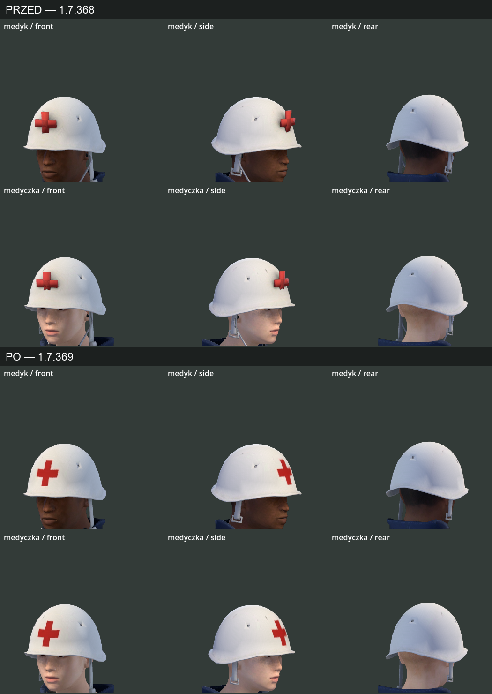
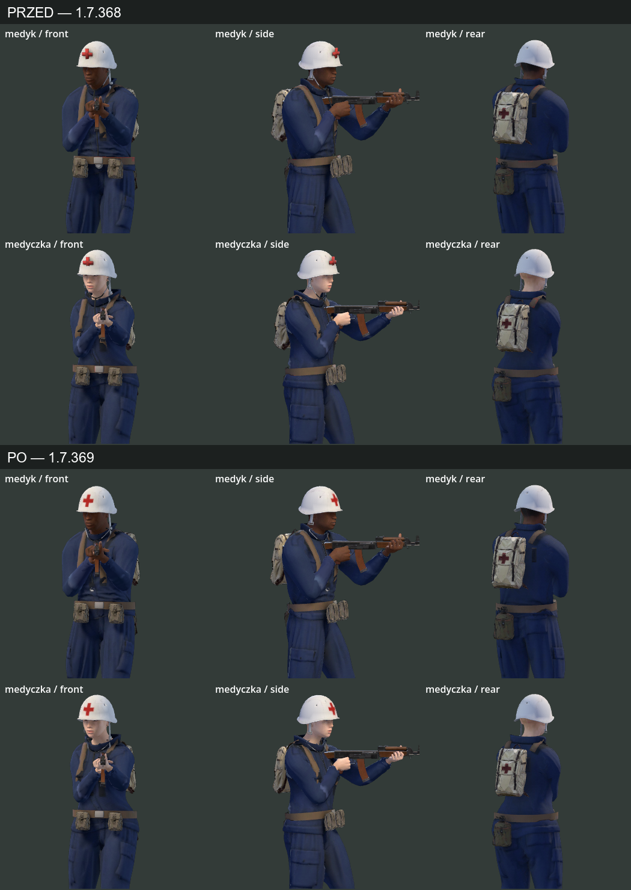

# Kask i osprzęt medyka — weryfikacja i poprawka 1.7.369

## Wynik i stan w kodzie

Sprawdzono oba modele MPFB używane w grze, na podstawie 1.7.368 po scaleniu PR #455. Poprawiono generator i przebudowano oba GLB. Krzyż jest teraz farbą w teksturze skorupy, a mocowania kasku i stetoskopu nie korzystają z odległych kości ramienia i bioder. Pewność wyników testów i danych geometrii: wysoka. Ocena wizualna obejmuje opisane ujęcia i paletę STANDARD.

| Element | Stwierdzony problem / stan 1.7.368 | Stan po poprawce i dowód |
|---|---|---|
| Krzyż kasku | Dwa prostopadłościany o grubości 8 mm, odsunięte od czaszy | Malowany znak 70 × 70 mm w istniejącym albedo skorupy, z odstępem od rantu. Bez dodatkowej geometrii i normalnej wypukłości. `char_mpfb.py:paint_helmet_cross`, `test_proportions.gd:_medic_equipment` |
| Skorupa i pasek | Wagi obejmowały Head, Neck, Spine2 i lewe ramię; hełm mógł się odkształcać przy celowaniu | Całość sztywno na Head. Zachowany fason źródłowego M1951: czasza, rant, otwory wentylacyjne i pasek. Granice geometrii zgodne z poprzednimi do dokładności 0,000001 m; 1800 trójkątów. `fit_medic_equipment` i dane obu modeli |
| Stetoskop | Wagi głowy i bioder; wysokość 0,627 / 0,605 m. Górna część zbyt wysoko względem nowej kurtki | Wagi Spine2/Neck, pałąk około 0,025 m nad kością szyi, wysokość 0,373 / 0,345 m. Dolna rurka dopasowana do kurtki z zachowanym przekrojem. `fit_medic_equipment` |
| Plecak medyczny | Głębokość 0,169 / 0,157 m; ustawianie według kwantyla wierzchołków mogło wpuszczać część modelu w plecy | Głębokość 0,123 / 0,114 m, wysokość 0,352 / 0,326 m. Dosunięty do kurtki na podstawie przedniej granicy bryły. `GEAR_MODELS:medbag`, `gear_model` |
| Szelki | Rzutowanie powierzchni obejmowało też stetoskop | Szelki rzutowane na ciało i ubranie z wykluczeniem stetoskopu. `char_mpfb.py:_surface`, `_harness` |
| Pas, ładownice, manierka | Mocowanie Hips było poprawne; konieczna kontrola w ruchu | Zachowane mocowania i wymiary. Ładownice: około 12 × 10 × 7 cm u medyka, 11 × 9 × 6 cm u medyczki. Manierka: około 21 / 19 cm wysokości. Ujęcia postoju, kucania i biegu z trzech stron |

Źródło zmian: [`prototype/tools/char_mpfb.py`](../../prototype/tools/char_mpfb.py). Przebudowane zasoby: `prototype/art/char3d/mpfb/male_medic.glb`, `female_medic.glb` oraz ich wyciągnięte tekstury i importy. Zmiany w albedo kurtki/spodni wynikają także z ponownego wypieku cieni osprzętu. Testy rozszerzono w [`prototype/tools/test_proportions.gd`](../../prototype/tools/test_proportions.gd), reprodukcję opisano w [`art_src/gear/SOURCE.md`](../../art_src/gear/SOURCE.md). Wersja i wpis historii: `prototype/project.godot`, `CHANGELOG.md`.

## Walidacja

- Regresja na modelach 1.7.368: **12 niepowodzeń** pierwszej kontroli osprzętu; test wykrywał niewłaściwe mocowania, brak krzyża w albedo i nieprawidłowe wymiary.
- Ostateczne modele, Godot 4.7.2: `test_proportions.gd` — **154 sprawdzenia, PASS**; także mocowania, wysokość pałąka względem szyi, krzyż w teksturze i wcześniejsze testy chwytu wszystkich sześciu postaci.
- `test_aim_points.gd` — **PASS**, maksymalne odchylenie wylotu modelu od rozgrywki **0,47 px świata**, limit 1,5 px.
- Blender, rzeczywiste siatki modelu: **0 nieważonych wierzchołków, 0 zdegenerowanych ścian, 0 braków UV i 0 nieskończonych współrzędnych**. Pomocnicza ikosfera kości tworzona przez importer nie jest siatką w GLB.
- `glb_glove_weights.py --check` — **PASS**. Po imporcie, kontroli VRAM i ponownym imporcie: `tex_vram.py --check` — **0 tekstur do poprawy**.
- Manifest materiałów Godota: **24 / 25** używanych tekstur medyka/medyczki; wszystkie pliki istnieją, brak nieużywanych WebP w tych dwóch przestrzeniach nazw.
- Forward+ Vulkan / RTX 3080: zbliżenia kasku od przodu, boku i tyłu; osprzęt w postoju, kucaniu z M83 +50° oraz biegu z M83 −50°. Dodatkowo **45 klatek** obu medyków z biegiem M83 +50° i ruchem/kucaniem z P-64. Kask utrzymuje kształt względem głowy, krzyż nie odstaje i nie przechodzi na rant; w sprawdzonych ujęciach nie występuje wcześniejsze rozciąganie stetoskopu.
- Podgląd porównania animacji nadal zgłasza wcześniejszy `Attempted to free invalid ID` przy zamykaniu, po zapisaniu 45 klatek (kod 0). Nie uznano tego błędu sprzątania za naprawiony. Zbliżenia zapisano bez błędów GDScript.

[Dane, wagi i SHA-256 obu modeli](2026-10-24-medic-helmet-equipment-data.json).

## Porównanie

[Kucanie +50°](images/medic-crouch-1.7.369.png) · [bieg −50°](images/medic-run-1.7.369.png) · [45 klatek porównania animacji](images/medic-equipment-motion-1.7.369.gif).

## Ryzyko i dalsze kroki

Modele mają **33 710 / 33 830** trójkątów, odpowiednio o 56 / 40 mniej niż w 1.7.368. Zachowano limit tekstur 1024 px. Krzyż korzysta z obecnego materiału kasku. Zmieniono mocowania i dopasowanie do ciała, bez wymiany szkieletu ani logiki rozgrywki.

Plecak, ładownice i manierka nadal mają powierzchniowe nierówności z pierwotnej generacji TRELLIS; ta poprawka nie jest ich ręczną retopologią. Nie sprawdzono każdej klatki powaleń/podnoszenia, wszystkich palet i czterech graczy na słabszym GPU. Następny krok: pełna kontrola osprzętu przy skrajnych pozach i reanimacji oraz czytelności czterech postaci nocą.
