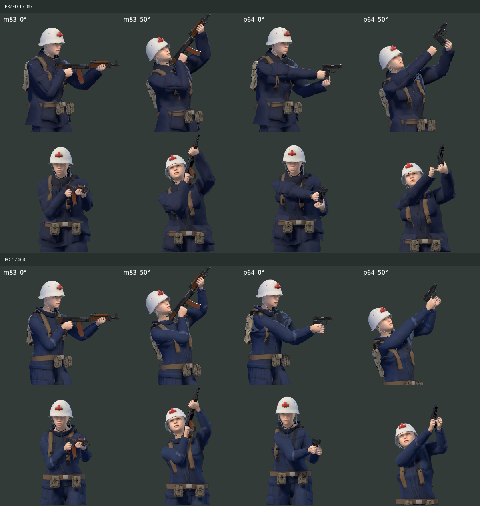
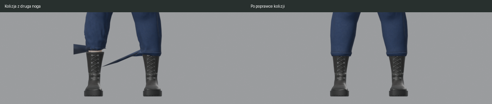

# Medycy i chwyt P-64 — wdrożenie 1.7.368

## Zakres i stan

Poprawka wdraża pierwszy zakres wynikający z [audytu 1.7.367](2026-10-24-character-quality.md). Zmieniono generatory, modele używane w grze i testy. Nie korzystano z płatnej generacji Meshy.

| Obszar | Stan w kodzie | Dowód |
|---|---|---|
| Mundur medyczki | Dopasowana kurtka i spodnie, symulowane na jej fenotypie MPFB | `prototype/tools/cloth_garments.py:WARDROBE`, dwa `art_src/clothes/female_medic_emt_*.glb` |
| Obaj medycy | Szyte mundury używane domyślnie przy przebudowie | `prototype/tools/char_mpfb.py:OUTFITS`, `build`, `sewn_default` |
| Materiały | Normalne kieszeni/fałd/szwów oraz zmienna szorstkość w GLB i shaderze gry | `cloth_garments.py:_final_material`, `char3d.gd:_prepare_materials`, `test_proportions.gd:_medic_uniform` |
| Nogawki i buty | Promień wychodzi od własnej nogi, aby nie zaczynał w bucie drugiej nogi | `cloth_garments.py:make_shell`, `push_out` |
| P-64 | Lewa dłoń obejmuje chwyt z boku, palce zgięte, barki podążają za celem IK | `char3d.gd:_left_hold`, `_pose_arms`, `PISTOL_CLAVICLE_*` |
| Położenie broni | Zachowany dotychczasowy punkt zasięgu P-64 w obliczeniu nominalnego wylotu | `char3d.gd:_gun_origin` |
| Kompresja | Walidacja obejmuje podkatalogi, normalne WebP/KTX2 i obrazy wspólne z albedo; ustawiono VRAM także w MPFB, FPP i podkatalogach świata | `tex_vram.py:main`, `normal_files`, `image_source`, `test_tex_vram.py` |
| Opis wyglądu | EN/PL opisuje granatowy mundur, biały hełm i stetoskop | `scripts/look.gd:OUTFIT_TEXT`, `translations/ui.csv` |

Mapy munduru: albedo, normalna i ORM po 1024×1024. ORM: R=1, G=szorstkość, B=0. Okluzja jest wypieczona w albedo, więc shader nie mnoży jej drugi raz przez mapę AO. Kolor granatowy, hełm, twarz, fryzura i identyfikacja obu medyków pozostają oparte na istniejących definicjach stroju. Ekwipunek jest składany przez obecny generator.

## Walidacja

- Godot 4.7.2, import i testy headless na Linux: **PASS**, bez błędów GDScript.
- `test_proportions.gd`: **138** pozytywnych sprawdzeń; wszystkie sześć postaci, oba mundury z mapami w shaderze, kontakt dłoni P-64 przy −50/0/50°, w obu kierunkach i przy kucaniu.
- Największy odstęp środków dłoni P-64 w tych próbkach: **0,088 m** (limit 0,10 m); medyk 0,069 m, medyczka 0,078 m. Palce lewej dłoni zgięte na chwycie.
- `test_aim_points.gd`: **PASS**; największe odchylenie lufy modelu od wylotu rozgrywki **0,47 px świata** (limit 1,5 px); niezależność od animacji i lustrzanie obu kierunków.
- Dodatkowe porównanie samej poprawki kodu chwytu ze stanem `main`: 168 kombinacji, nominalne punkty P-64 identyczne (0 px różnicy).
- Blender: oba GLB mają **0 nieważonych wierzchołków, 0 zdegenerowanych ścian, 0 braków UV i 0 nieskończonych współrzędnych**.
- `glb_glove_weights.py --check`: **PASS** dla wszystkich sześciu postaci.
- `test_tex_vram.py`: **PASS** — regresja pomijanego podkatalogu, normalnej WebP bez opisowej nazwy i obrazu współdzielonego z albedo. `tex_vram.py --check`: **0 tekstur do poprawy**, po ponownym imporcie. Wszystkie 14 map normalnych obu medyków mają jawnie ustawioną kompresję VRAM/RG. Poprawka dotyczy także ustawień importu w podkatalogach FPP, lasu, decals i HDRI.
- Kontrola obrazu na RTX 3080, Forward+ Vulkan: M83/P-64 przy 0/50°, próbka przeładowania P-64, 45 klatek biegu/kucania obu medyków oraz nocna misja z medyczką (`--look=10`) przy zwykłym zoomie. W sprawdzonych ujęciach nie występuje wcześniejsze otwieranie kurtki medyczki pod uniesioną ręką ani odstające nogawki.
- Narzędzie porównania animacji nadal zgłasza `Attempted to free invalid ID` podczas zamykania, po zapisaniu klatek (kod 0); to wcześniejszy problem sprzątania podglądu. Nie uznano go za poprawiony w tej zmianie. Zbliżenia i ujęcie misji zapisano bez błędów GDScript.

[Dane kontroli](2026-10-24-medic-polish-data.json).

## Porównanie wizualne

[Wszystkie sześć postaci](images/characters-overview-1.7.368.png) · [bieg i kucanie obu medyków](images/medic-motion-1.7.368.gif) · [przeładowanie P-64](images/medic-reload-1.7.368.png) · [nocna misja, zwykły zoom](images/medic-night-1.7.368.png).

## Ryzyko i dalsze prace

Nowe mundury zwiększają liczbę trójkątów obu medyków z około 31 tys. do około 34 tys. (około 9%). Zachowano limit tekstur 1024 px i kompresję VRAM. Pełne porównanie wydajności na słabszym GPU oraz czytelność czterech graczy w nocnej misji pozostają kolejnym krokiem.

Kontrola wybranych póz nie obejmuje wszystkich animacji powaleń, podnoszenia, wszystkich palet ani mimiki. Raport rozdziela kontrolę geometrii i materiałów od oceny wyglądu w rendererze gry. Pewność stwierdzeń sprawdzonych testami: wysoka; ocena wizualna dotyczy opisanych ujęć.
