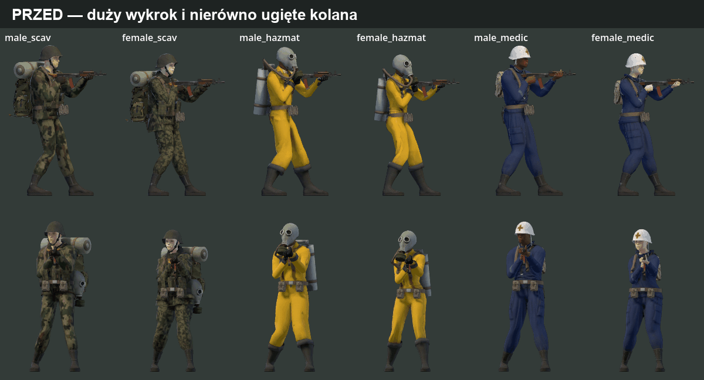
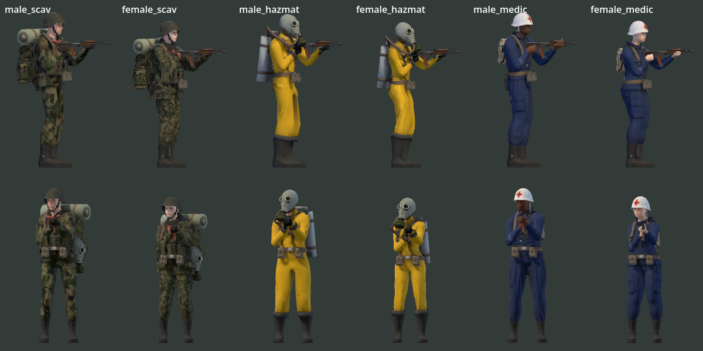
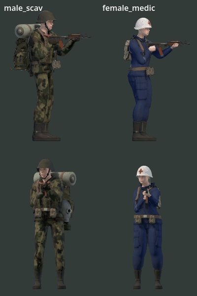

# Pozycja stojąca — nogi, kolana i podparcie stóp

## Wynik

Wdrożone w kodzie w wersji **1.7.372**, dla wszystkich sześciu wyglądów MPFB. Klip postoju z biblioteki dawał duży wykrok, niesymetryczne zgięcie kolan i niekontrolowany skręt uda/goleni. Korekta ustawia krótsze podparcie, prowadzi kolana w anatomicznej płaszczyźnie i zachowuje płaskie buty.

Pewność: wysoka dla sprawdzonych modeli i stanów. Podglądy pochodzą z rzeczywistego renderu Godota 4.7.2 Forward+ / Vulkan na RTX 3080.



## Pomiary

Pomiary spokojnego postoju w przestrzeni szkieletu; obie płcie, scav/hazmat/medic, M83, celowanie poziome. „Przed” to kod scalonego PR #457; „po” to poprawka 1.7.372.

| Parametr | Przed | Po |
| --- | --- | --- |
| Wykrok między kostkami | 43–49 cm | 9–10 cm |
| Rozstaw poprzeczny stóp | ok. 41–48 cm | ok. 27–31 cm |
| Ugięcie kolan w spokojnym postoju | ok. 11° / 35–37° | ok. 18° / 18–19° |
| Kierunek podparcia | z retargetowanego klipu | lekko na zewnątrz, dopasowany do bioder |

Test ruchu obejmuje także skrajne celowanie, strzał, przeładowanie i kilof. Stopy mają zachować podparcie, a kolana amortyzują nakładkę ciała bez wydłużania kości.

## Implementacja

- [`char3d.gd`](../../prototype/scripts/char3d.gd), `set_look`: cele stóp z szerokości bioder i długości nóg; pozycja kostek oraz orientacja butów z modelu. Oś kolana mierzona z anatomicznej pozy spoczynkowej.
- `_pose_body`: korekta położenia bioder zapisana przed nakładką walki, dzięki czemu zachowuje ruch bioder z ciosu i odrzutu. Udział korekty wynika z istniejących wag lokomocji; zanika podczas ruchu, chwytania, wspinania i upadku.
- `_ground_hips`: zapas ugięcia kolan przy podparciu; powrót do podparcia po upadku jest wygaszany płynnie.
- `_two_bone` / `_roll_to`: prowadzenie osi uda i goleni zamiast przypadkowego skrętu wokół kości.
- `_pose_legs`: korekta toru stóp, kierunku kolan, płaskiego ustawienia stóp i palców. Bazy są ortonormalizowane przed interpolacją, także podczas wstawania.
- [`test_standing_legs.gd`](../../prototype/tools/test_standing_legs.gd): geometria i ruch dla sześciu wyglądów, obu kierunków, 30/60/120 kl./s oraz wariantów z klipami i bez. Sprawdza długości kości, ugięcie i skręt kolan, wysokość kostek i palców, płaskość podeszwy, utrzymanie podparcia podczas akcji oraz wygaszenie ruchu po biegu/kucaniu/skoku/upadku.
- [`tests.yml`](../../.github/workflows/tests.yml): nowa regresja wykonywana w CI, z odrzuceniem błędów skryptów i błędów silnika.

## Podgląd



Poniżej powrót do postoju po biegu i kucaniu: male_scav oraz female_medic, widok z boku i od przodu. Narzędzie renderuje wszystkie sześć wyglądów; GIF pokazuje dwie kolumny w powiększeniu.



Powtórzenie renderu:

```bash
godot --path prototype -s tools/shot_standing3d.gd -- --out=/tmp/standing --frames=180
godot --path prototype -s tools/shot_standing3d.gd -- --out=/tmp/standing-motion --motion --frames=300
```

## Walidacja i zakres

Korekta dotyczy wizualnej pozy gracza w lokalnej płaszczyźnie podłoża. Nie dodaje dopasowania stóp do dowolnych pochyłych powierzchni ani nowego klipu biegu. Symulacja, hitboxy i autorytatywne trafienia pozostają w istniejącym systemie 2D.

Kontrole lokalne (Godot 4.7.2):

- Pozycja stojąca i przejścia: **PASS, 648 223 kontrole**; maksymalne odchylenie osi kolana 0,0013°, maksymalny dryf podparcia 0,002 mm, bez wydłużania nóg. Ruch po ustaleniu postoju poniżej 0,098 m/s (limit 0,8 m/s).

- Kontakt dłoni: **PASS, 87 408 próbek**; największa szczelina dłoni do celu 0,98 mm, bez wydłużania ramion.
- Animacje walki: **PASS, 261 kontroli**; odchylenie głowicy kilofa 18,735° w dopuszczalnym stożku 50°, brak penetracji płaszczyzny podłoża, pionowe przemieszczenie stóp do 1,44 mm przy kucaniu.
- Punkty celowania: **PASS**; maksymalne odchylenie wylotu modelu 0,79 px przy limicie 1,5 px; nominalny tor nie zależy od animacji.
- Proporcje i wyposażenie: **PASS**.
- Import i start headless: bez błędów skryptów; kontrola kompresji VRAM: **0 tekstur do poprawy**.
- Render sześciu wyglądów, przejść i użycia broni: bez błędów silnika.
