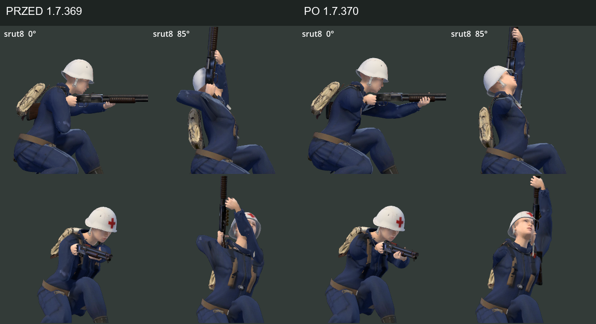
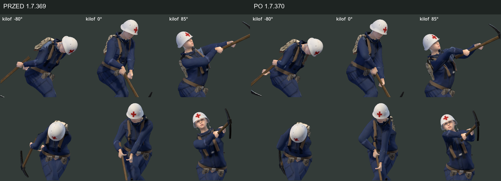
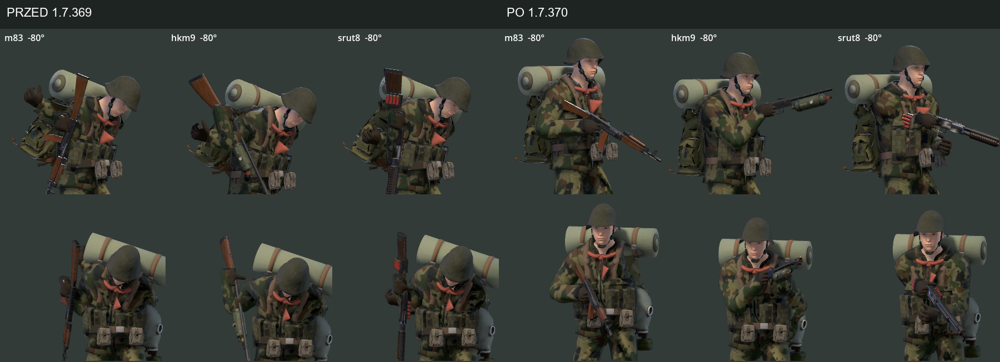

# Chwyt broni i układ rąk — poprawka 1.7.370

## Zakres i wynik

Audyt dotyczy sześciu postaci MPFB i proceduralnych animacji TPP używanych w grze. Podstawa: `514ae07`, wersja 1.7.369 po PR #456. Sprawdzono dziesięć broni palnych, maczetę i kilof, oba kierunki oraz kąty −80°, −50°, 0°, 50°, 85°. Macierz pomiarowa obejmuje postój, bieg, skok, opadanie, kucanie i marsz w kucaniu; przeładowanie/cykl w postoju i kucaniu, zamach w postoju. Ocena wizualna korzysta ze zbliżeń Forward+ Vulkan i nagrania kolejnych klatek wybranych przypadków. Pewność pomiarów kości: wysoka; ocena kontaktu powierzchni siatek ograniczona do tych ujęć.

## Stwierdzone problemy i zmiany w kodzie

| Problem w 1.7.369 | Poprawka |
|---|---|
| Lewa ręka nie dosięgała łoża przy skrajnych kątach, szczególnie w kucaniu po zwrocie w lewo | `_grip_shoulder`, `_grip_arm`: bark podąża za chwytem zależnie od wymaganego zasięgu. `_fit_weapon_grips` dopasowuje widoczną broń do obu rąk, z pierwszeństwem korekty głębokości |
| Poprawna pozycja nadgarstka maskowała wygięcie dłoni do tyłu oraz prawie całkowicie złożony łokieć | `_grip_pole` prowadzi łokieć ku orientacji dłoni. Ograniczony promień chwytu utrzymuje zgięcie łokcia w granicach około 145°, z zapasem przed pełnym wyprostem i bez zmiany długości kości |
| Punkty pobierania amunicji obracały się razem z lufą i wykraczały poza zasięg ręki | `_left_weapon_pose`, `_left_path`: pas jest w układzie ciała; tułów i broń schodzą ku dłoniom podczas przeładowania. Odsunięcie broni oraz przejście od nominalnego chwytu do pozy przeładowania są płynne |
| Kilof gubił podparcie podczas zamachu | `_pickaxe_hand` i `_pose_left_melee` korzystają ze wspólnego dopasowania obu chwytów i barku |
| Niezależny wybór głębokości w każdej klatce powodował skoki między rozwiązaniami IK | `_grip_depth_offset` wybiera gałąź bliską poprzedniej klatce i stopniowo wraca do nominalnej głębokości; reset przy zmianie postaci/broni. Test obejmuje pełne sekwencje klatek |

Źródło: [`prototype/scripts/char3d.gd`](../../prototype/scripts/char3d.gd). Punkty strzału `aim_points` i nominalny algorytm `_gun_origin` pozostają takie same; dopasowanie dotyczy modelu. Brak zmian szkieletów, GLB, tekstur, statystyk broni oraz zależności. Wersja i historia: `prototype/project.godot`, `CHANGELOG.md`.

## Pomiary i testy

| Przebieg | Pomiary dłoni | Maksymalna szczelina przed | Maksymalna szczelina po |
|---|---:|---:|---:|
| Trzymanie broni | 8 640 | 179.48 mm | 0.347 mm |
| Przeładowanie | 50 400 | 435.65 mm | 0.234 mm |
| Cykl pompki / zamka | 10 080 | 178.37 mm | 0.001 mm |
| Zamach | 5 040 | 248.11 mm | 0.001 mm |

- Macierz przed/po: **74 160 pomiarów** na każdą wersję; po poprawce żaden cel nadgarstka nie jest oddalony o więcej niż 5 mm. Dokładne wyniki i najgorsze przypadki: [dane JSON](2026-10-24-weapon-hand-poses-data.json).
- `test_weapon_grips.gd`: **PASS, 87 408 pomiarów**. Maksimum w tej macierzy: szczelina **0,25 mm**, nadgarstek **77,89°**, łokieć **145,03°**; długości kości zgodne z pozycją spoczynkową. Sekwencje ciągłości obejmują dwa modele, pięć broni, 180 klatek każdej akcji; maksymalny krok broni **9,47 cm** przy przyspieszeniu ciosu kilofem, limit 12 cm.
- `test_aim_points.gd`: **PASS**, maksymalne odchylenie lufy **0,47 px świata**, limit 1,5 px; także kierunki lustrzane, niezależność od animacji i osiem konfiguracji podzespołów broni.
- `test_proportions.gd`: **PASS**, 154 wcześniejsze sprawdzenia, w tym skinning rękawic, zgięcie palców, kontakt dłoni P-64 i osprzęt medyków.
- Parser ostatecznego `test_weapon_grips.gd`: **PASS** (`--check-only`), także po ujednoliceniu limitu nadgarstka do 90°; zaobserwowane maksimum było niższe. Zbliżenia i **47 zapisanych klatek** animacji Forward+ Vulkan: bez błędów GDScript i błędów sprzątania w logu.
- Mikrobenchmark CPU: 240 wywołań `Char3D.update` na przypadek, male_scav, Windows, bez renderowania. Mediany **0,17–0,66 ms po** wobec **0,14–0,19 ms przed**; 95. percentyl po **0,27–1,41 ms**. To pomiar pojedynczej postaci przy równoległej walidacji, nie wynik FPS ani budżet na słabszym CPU.
- Pełne CI GitHub obejmuje dodatkowo testy misji, sieci, broni i strzelnicy FPP. Wynik jest widoczny w PR.

Szczelina oznacza różnicę między zamierzonym celem nadgarstka i pozycją kości po rozwiązaniu IK. Nie jest pomiarem odległości każdego palca od siatki broni. Kąt nadgarstka to kierunek przedramienia względem anatomicznej osi dłoni przed zgięciem palców; stanowi kontrolę techniczną, nie medyczną ocenę zakresów ruchu.

Nowy [`prototype/tools/test_weapon_grips.gd`](../../prototype/tools/test_weapon_grips.gd) jest podłączony do `.github/workflows/tests.yml`. Sprawdza kontakt, stałą długość ramienia/przedramienia, ograniczenia stawów, przebieg przeładowania/cyklu/ciosu oraz ciągłe celowanie i obrót. Wariant testu na wcześniejszym kodzie medyczki wykazał **1 598 naruszeń w 12 768 pomiarach dłoni**; nie obejmował później dodanej sekwencji ciągłości.

## Ujęcia

[Wszystkie bronie: karabiny](images/weapon-grips-rifles-1.7.370.png) · [broń specjalna](images/weapon-grips-specials-1.7.370.png) · [broń ciężka](images/weapon-grips-heavy-1.7.370.png) · [pistolet i broń biała](images/weapon-grips-small-1.7.370.png).

[Nagranie wybranych animacji](images/weapon-grips-motion-1.7.370.gif) · [zgięcie nadgarstków przy celowaniu w dół](images/weapon-grips-down-before-after-1.7.370.png).

## Ograniczenia i dalsza kontrola

Nadal jest to proceduralny chwyt z punktów broni oraz pomiaru dłoni, a nie ręcznie opracowany klip każdego palca. Test nie kontroluje kolizji wszystkich opuszek, kabłąka, spustu i osprzętu w każdej klatce. Osobny system rąk FPP (`prototype/scripts/range3d/fp_rig.gd`, `prototype/tools/fp_grip.py`) nie był przebudowywany; wyniku TPP nie należy przenosić na wszystkie chwyty FPP.

Koszt dopasowania CPU sprawdzono osobno od renderowania; szczegóły w danych. Następna kontrola: cztery postacie w ruchu na docelowym słabszym sprzęcie oraz ręczne dopracowanie spustu/kciuka i podzespołów magazynka dla poszczególnych broni. Kontrola rękawic i proporcji zachowuje wcześniejsze regresje, lecz nie zastępuje sprawdzenia wszystkich kolizji powierzchni.
