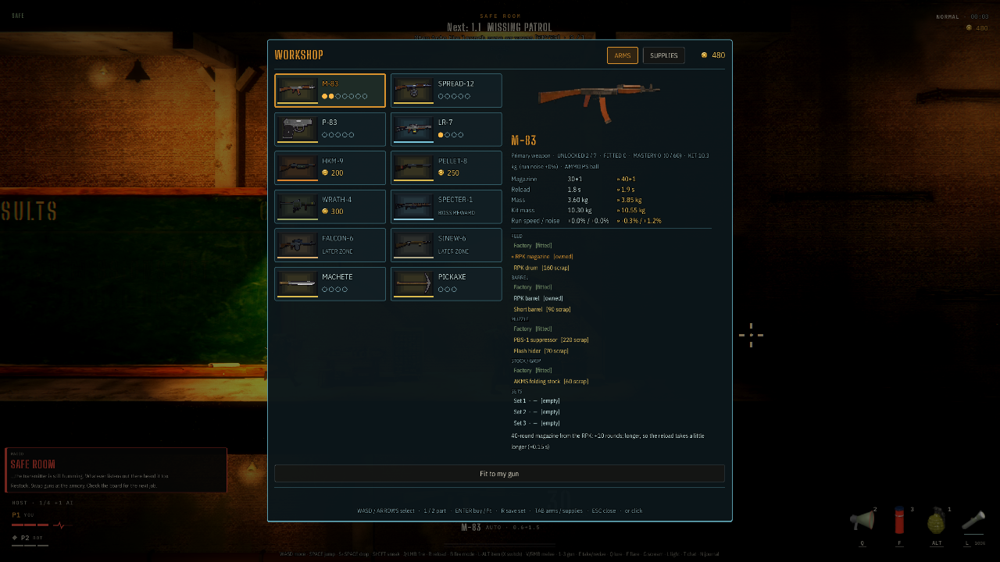

# Wdrożenie usprawnień ulepszania broni — Dead Air ’87

Data: 2026-10-24. Repo: `ssiwm/gameon`. Gałąź: `fix/weapon-workshop-flow`, baza `52498c9`. Wersja: **1.7.367**.

## Wynik i zakres

Wdrożono korekty istniejącego systemu części i siedmiu stanowisk. Architektura Godot, symulacja 2D, prezentacja 3D, ceny części i układ kryjówki zostały zachowane. Nie dodano zależności. Zmiany wynikają z [audytu wyjściowego](2026-10-24-weapon-upgrades.md).

| Obszar | Stan po wdrożeniu | Dowód w kodzie |
|---|---|---|
| Magazynek i zestawy | Zmiana konfiguracji rozlicza przeładowanie przed zmianą definicji, ogranicza magazynek, zachowuje rodzaj nabojów i komorę; większy magazynek nie tworzy amunicji | [player.gd](../../prototype/scripts/player.gd#L485), `weapon_controller.configuration_changed`, `_cancel_reload`, `_on_rounds_granted` |
| Pełny zapas | Zwrócone zwykłe naboje czekają w `Arsenal.returned` i są zużywane przed zwykłą pulą. Specjalne czekają w zapisanej dostawie | [arsenal.gd](../../prototype/scripts/arsenal.gd#L312), `_return_rounds`, `take_rounds` |
| Autoryzacja | Serwer sprawdza tryb, rzeczywistą kryjówkę, połączonego żywego człowieka i pozycję względem właściwego stanowiska. Flaga lokalnego UI nie autoryzuje innego peera | [scrap.gd](../../prototype/scripts/scrap.gd#L102), `station_reason`, `supply_station` |
| Powtórzenia | Limit 350 ms dla powtórzenia tej samej operacji; posiadane części nie są kupowane ponownie, a konkretna lufa/sprężyny są wymieniane raz na pobyt w kryjówce | `scrap._permit_action`, `_service_server`, [main.gd](../../prototype/scripts/main.gd#L397) |
| Montaż osobisty | Brak wyboru oznacza fabryczną część. Zakup montuje część kupującemu; pozostałym graczom nie zmienia konfiguracji | [profile.gd](../../prototype/scripts/profile.gd#L401), `fitted`, `scrap._part_done` |
| Migracja | Wersjonowana migracja utrwala wcześniejszy automatyczny montaż, również dla starego postępu bez osobnego pliku profilu | `profile.migrate_fits`, `load_from`, `profile/fits_version`; `scrap.legacy_fits`, `workshop/fit_policy_version` |
| Kolejki | Części w badaniu, produkcji lub z gotowym schematem są wykluczone z puli znalezisk. Zbędny opłacony etap po konflikcie ze znaleziskiem/starym zapisem zwraca koszt | [scrap.gd](../../prototype/scripts/scrap.gd#L220), `find_candidates`, `_reconcile_jobs` |
| Dostawy | Reszta nieprzyjętych nabojów pozostaje w `deliveries`, przechodzi zapis i synchronizację. Zwrot podczas misji jest tymczasowy i cofa się wraz z zapasem po wipe; udana misja go zatwierdza. Zapis postępu przed ekstrakcją również korzysta z punktu kontrolnego, więc nie utrwala tymczasowego zwrotu. Odbiór przy prasie; 40 mm przy pirotechnice | [scrap.gd](../../prototype/scripts/scrap.gd#L835), `_claim_server`, `_deliver_ready`, `_sync`, `load_progress`, `save_progress` |
| Wybór broni | Pracownia/tokarka/konserwacja filtrują bronie według rzeczywistych opcji. Domyślny wybór uwzględnia zlecenie/schemat, zapamiętany wybór i noszoną broń | [workshop_ui.gd](../../prototype/scripts/workshop_ui.gd#L1275), `_arms_list`, `_initial_selection` |
| Porównanie | Rzeczywisty nabój w magazynku; osobno odblokowane i zamontowane części. Podgląd pokazuje zmienione statystyki, w tym dobycie, rozrzut, odrzut, przebicie, grzanie i wpływ masy zestawu na bieg | [workshop_ui.gd](../../prototype/scripts/workshop_ui.gd#L1317), `_comparison_rows`, `_refresh_detail` |
| Czytelność | Przewijany korpus, odsłanianie operacji wybranej klawiszami/padem, stale widoczna główna akcja i wspólne podsumowanie badań, tokarki, schematów oraz oczekujących dostaw | `workshop_ui._scroll_body`, `_reveal_option`, `_queue_summary` |
| Dane do playtestów | Dziennik hosta zapisuje czas przygotowań `hub_seconds`, zestawy ludzi `equipment` i stan ekonomii `workshop`, do zestawienia z późniejszym wynikiem misji | [mission.gd](../../prototype/scripts/mission.gd#L500), `log_start`, istniejący `SessionLog` |

## Stan stanowisk

Wszystkie pozostają zaimplementowane w istniejącym układzie kryjówki: ława rusznikarska, szafki, konserwacja, prasa, pirotechnika, pracownia i tokarka/szlifierka. Zestawy części nadal są prywatne; bezpłatne próby na strzelnicy pozostają dostępne. Rozdzielenie funkcji stanowisk jest egzekwowane także po stronie serwera, a nie tylko przez zakładki UI.

## Walidacja

Testy wykonano na źródłach, oficjalnym Godot **4.7.2** (`ed1daf0bf`), z odizolowanymi katalogami danych użytkownika. Nie używano wcześniejszego eksportu do testowania zmienionego kodu.

- Warsztat: **52/52** — prawdziwa kryjówka, autoryzacja, duplikaty, magazynki, spóźnione przeładowanie, migracje, kolejki, częściowe dostawy, zapis/snapshot i UI. Źródło: [workshop_test.gd](../../prototype/scripts/workshop_test.gd).
- Bronie: **379/379** — istniejący pełny zestaw regresji.
- Strzelnica FPP: **79/79** — dotychczasowe próby i zachowanie zapasów po wyjściu.
- ENet: **11/11 po stronie hosta**, dodatkowe asercje klienta — odrzucenie operacji spoza kryjówki, poprawny montaż osobisty, zdalne zakupy/badanie/serwis przy stanowiskach oraz odbiór dostawy bez podwójnej opłaty i dodatkowych nabojów.
- `git diff --check`, składnia skryptu testów i **27** nowych tłumaczeń: unikalne klucze, zgodne parametry formatowania; dodatkowo **1095** wpisów CSV zgodnych z wygenerowanym zasobem polskich tłumaczeń.
- Przejście misja → kryjówka → następna misja: **GEN-TEST PASS, 0 błędów**. Zweryfikowano również zapis czterech startów misji z zestawami i stanem warsztatu; po pobycie w kryjówce log zawierał `hub_seconds`.
- Kontrola układu panelu na zrzucie 1280×720 w trybie Compatibility/OpenGL.

CI uruchamia nowy test warsztatu. Skrypt testów broni sprawdza także błędy GDScript, brak podsumowania oraz status klienta — sama zakończona korutyna nie może dać pozornego sukcesu.

```bash
godot --headless --path prototype --import
godot --headless --path prototype -- --host --port=8952 --workshoptest --autoquit=60
bash prototype/tools/test_weapons.sh
godot --headless --path prototype -- --host --rangetest --autoquit=75
```

## Zmienione pliki

Logika: `arsenal.gd`, `scrap.gd`, `profile.gd`, `player.gd`, `weapon_controller.gd`, `workshop_ui.gd`, `main.gd`, `mission.gd`.

Testy: `weapon_test.gd`, nowy `workshop_test.gd` wraz z `.gd.uid`, `tools/test_weapons.sh`, `.github/workflows/tests.yml`.

Dokumentacja i wersja: `prototype/project.godot`, `prototype/translations/ui.csv` i wygenerowany `ui.pl.translation`, `prototype/README.md`, `prototype/WEAPONS.md`, `GDD.md`, `CHANGELOG.md` oraz raporty audytu.

## Ograniczenia i następny krok

Pewność wysoka dla sprawdzonych przepływów kodu i lokalnej sieci ENet. Nie wykonano zewnętrznych sesji ani testu Steam. Kontrola obrazu dotyczyła panelu w Compatibility/OpenGL; ten tryb zgłasza istniejące ograniczenia mgły, a testy headless ostrzegają o zasobach przy zamykaniu procesu. Nie są to błędy wykonania GDScript.

Host i klienci powinni używać tej samej wersji **1.7.367** — zmieniły się komunikaty synchronizacji zapasu/dostaw. Pozycja i magazynek pozostają własnością klienta zgodnie z istniejącym modelem kooperacji; kontrola stanowisk nie stanowi pełnego systemu przeciwdziałania oszustwom.

Następny krok: trzy zewnętrzne sesje według GDD, z pomiarem czasu przygotowań, rozumienia kolejki pracownia → tokarka, częstotliwości zmiany zestawów i wykorzystania zakupionych części. Wyniki powinny zdecydować o dalszym uproszczeniu UI i balansie cen; kolejne stanowiska lub waluty nie są teraz rekomendowane.

## Podgląd panelu


