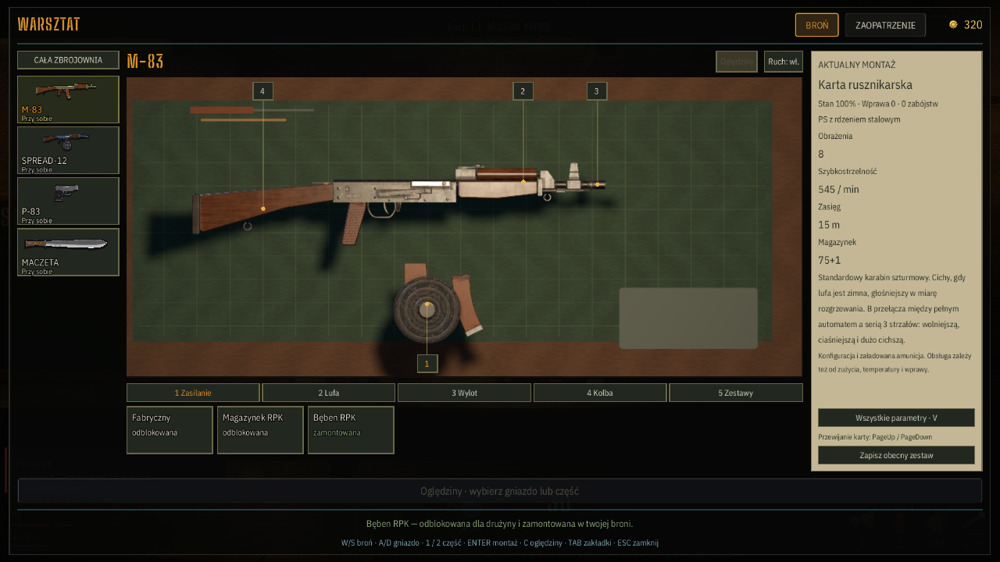

# Integracja warsztatu i zamykania gry — 1.7.385

## Zakres

Zmiany przygotowane do PR na bazie `main` (`237a515`, wersja 1.7.384). Aktualne gabloty z 1.7.379, sterowanie H / F, modele, kalibracja jasności i efekty burzy zostały zachowane. Lokalny warsztat 3D i wspólna procedura zamykania otrzymują numer 1.7.385. Wszystkie 145 ścieżek ze wstępnego commita lokalnych zmian są obecne po rebase; część zawartości była już wdrożona w main.

Zaimplementowane: stanowisko ARMS, podgląd konfiguracji, wybór gniazd, porównanie, animacja po zatwierdzeniu, klawiatura/pad, EN/PL, regresje i sprzątanie audio. Dokumentacja i materiały dodatkowe: koncepcje HUD-u, kadry postaci, plany stroju, instrukcja wydania Steam, narzędzia i filmy trailera. Pliki dodatku Tripo Bridge są dołączone; nie włączono go w konfiguracji edytora. MP4 i AVI są przechowywane przez Git LFS, zgodnie z dodanymi regułami w `.gitattributes`.

Podczas integracji test sterowania z main uruchamiał audio, a kończył przez bezpośrednie `SceneTree.quit()`. Zakończenie `tools/test_input_bindings.gd` skierowano przez `Audio.quit_game()`. Ponowny przebieg nie pozostawia zasobów audio.

## Weryfikacja po integracji

Godot 4.7.2, natywny Windows. Osobne nazwy aplikacji i userdata dla projektów testowych. Logi: `C:/deadair87/reports/pr-all-changes-2026-10-25`. Wyniki zapisano w [danych walidacji](2026-10-25-pr-integration-data.json).

| Test | Wynik |
|---|---|
| Sterowanie / zgodność menu | 100/100 |
| Warsztat | 85/85 |
| Gabloty | 50/50 |
| Strzelnica | 79/79 |
| Bronie | 379/379 |
| ENet host | 14/14 |
| ENet klient | 6 PASS, ukończenie operacji warsztatu |
| Własność węzłów i zamykanie audio | 10/10 |
| Render PL, montaż bębna M-83, D3D12 Forward+ / WASAPI | `layout_ok=true`, kod 0, 1280×720 |

Wszystkie dziewięć końcowych procesów: kod 0, brak błędów skryptów, ostrzeżeń i komunikatów o wyciekach. Czas procedury wyjścia 102,868–114,941 ms. Pierwszy import po aktualizacji zgłosił nieznane UID z poprzedniego cache; ponowny import zakończył się czysto. `git diff --check` i kontrola zmian staged są poprawne.

## Granice potwierdzenia

Walidacja lokalna nie zastępuje zdalnego CI, testu fizycznego kontrolera ani transportu Steam/WAN. Przebieg renderu dotyczy M-83; wcześniejszy audyt warsztatu zawiera weryfikację pozostałych broni i wariantów. Materiały koncepcyjne oraz instrukcja Steam nie oznaczają wdrożenia tych koncepcji ani wydania gry. Opis diagnozy audio i pozostałych ścieżek zamykania: [raport wycieków](2026-10-25-shutdown-leaks.md).
